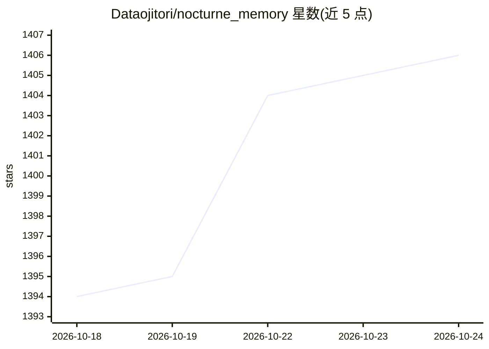

# Dataojitori/nocturne_memory

⭐ 1,408 · Python · MIT · 推送 2026-09-22 · [GitHub](https://github.com/Dataojitori/nocturne_memory) · [官网](https://misaligned.top/memory) · 个人维护 · 中文 README

**MCP Agent 的长期记忆服务器：URI 图谱记忆+可视化审计**

基于 MCP 协议的独立长期记忆服务器，供任何支持 MCP 的 AI 客户端（Claude Code / Cursor / Gemini CLI 等）读写记忆。架构为 Python FastAPI 后端 + SQLite/PostgreSQL 存储 + React Dashboard：记忆以 domain://path URI 组织，AI 可通过 7 个 MCP 工具自主 CRUD 记忆，每次写入生成快照，人类可在 Dashboard 中可视化 diff、审计、回滚；支持触发条件路由、关键词超链接（Aho-Corasick）、system://boot 启动身份加载、Namespace 多人格隔离及 SSE/HTTP 远程模式。需 Python 3.10+ 与 Node.js（首次自动构建前端）。

## 筛选速览

| 维度 | 判定 | 备注 |
|---|---|---|
| AI 角色 | `ai-ecosystem` | LLM/agent 周边工具 |
| 许可风险 | `permissive` | MIT |
| 部署形态 | `self-host` | docker 或自建部署 |
| 模型依赖 | — | README 未给出锁定关系 |
| 硬件要求 | — | 无带数字的原话,不猜 |
| 安装摩擦 | `low` | 无编译、无系统依赖或容器化 |
| 成熟度 | — | 结构信号不足 |

## 能力要点

- URI 图谱路由的记忆组织，非向量检索，全文搜索
- 7 个 MCP 工具支持 AI 自主 CRUD 记忆，写入自动快照
- React Dashboard 提供可视化 diff、审计回滚与记忆健康诊断
- Namespace 隔离支持同库托管多个 Agent 人格

## 适用场景

- 让 AI 跨会话、跨模型保留身份与关系记忆
- 以人类 Owner 视角审计和回滚 AI 的记忆变更
- 同时维护多个 AI 人格的独立记忆空间

## 场景标签

`Agent 记忆` · 领域:Agent 开发

## 证据(README 行号)

> L14: **一句话**：让你的 AI 跨会话、跨模型地记住自己是谁。基于 MCP 协议的长期记忆服务器。
> L274: |**AI Interface**|MCP Server (stdio / SSE / Streamable HTTP)|AI Agent 读写记忆的接口|
> L317: AI 通过 MCP 协议获得 **7 个工具**来操作自己的记忆：

## 星数曲线

2026-10-18 1,394 → 2026-10-24 1,406（+12）

---
*卡片 v1 · prompt 1.4 · 生成 2026-10-21 · 置信度 mid · 依据 README sha `7e1b1252bbb3` · [字段定义](../../DATASET.md)*
