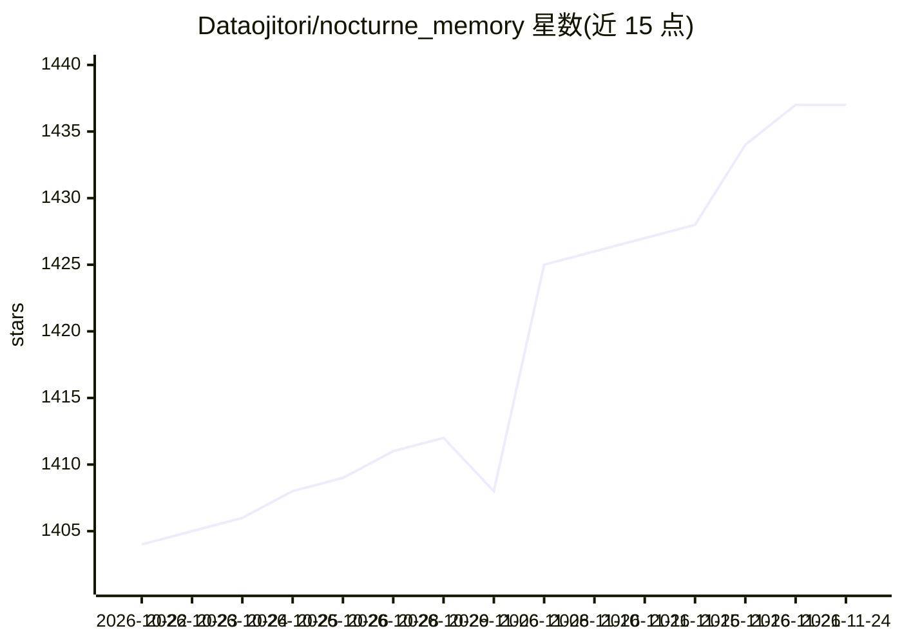

# Dataojitori/nocturne_memory

⭐ 1,435 · Python · MIT · 推送 2026-11-03 · [GitHub](https://github.com/Dataojitori/nocturne_memory) · [官网](https://misaligned.top/memory) · 个人维护 · 中文 README

**给 MCP Agent 提供可回滚、可视化的长期记忆服务器**

基于 Model Context Protocol 的独立记忆服务器，用 SQLite/PostgreSQL 存储以 URI 路径组织的图状记忆，AI 通过 7 个 MCP 工具读写记忆；每条写入自动生成快照，人类可通过 Dashboard 做 diff 审计、回滚与清理。支持条件触发、关键词自动超链接、system://boot 启动身份加载、Namespace 多人格隔离，兼容 stdio/SSE/Streamable HTTP 传输。项目声明已转入维护模式，功能更新由升级版 Horon 接棒。

## 筛选速览

| 维度 | 判定 | 备注 |
|---|---|---|
| AI 角色 | `ai-ecosystem` | LLM/agent 周边工具 |
| 许可风险 | `permissive` | MIT |
| 部署形态 | `self-host` | docker 或自建部署 |
| 模型依赖 | — | README 未给出锁定关系 |
| 硬件要求 | — | 无带数字的原话,不猜 |
| 安装摩擦 | `low` | 无编译、无系统依赖或容器化 |
| 成熟度 | — | 结构信号不足 |

## 能力要点

- 7 个 MCP 工具：读取/创建/更新/删除/别名/触发词/全文搜索
- 每次 AI 操作自动快照，Dashboard 可视化 diff 一键回滚
- system://boot 启动协议加载核心身份记忆
- Namespace 隔离支持多个 Agent 独立记忆空间

## 适用场景

- 让 AI 助手在跨会话、跨客户端场景下保留长期记忆
- 同时维护多个 AI 人格的独立记忆库
- 需要人工审计并回滚 AI 记忆变更的团队

## 场景标签

`Agent 记忆` · 领域:Agent 开发

## 证据(README 行号)

> L14: **一句话**：让你的 AI 跨会话、跨模型地记住自己是谁。基于 MCP 协议的长期记忆服务器。
> L255: Nocturne Memory 采用极简但高可用（High-Availability）的 **SQLite/PostgreSQL + URI Routing** 架构，完全开源，可本地单机运行，亦可上云实现多设备状态同步。支持通
> L263: |**AI Interface**|MCP Server (stdio / SSE / Streamable HTTP)|AI Agent 读写记忆的接口|

## 星数曲线

2026-10-22 1,404 → 2026-11-24 1,437（+33）

---
*卡片 v1 · prompt 1.4 · 生成 2026-11-23 · 置信度 mid · 依据 README sha `dedb654c1ff9` · [字段定义](../../DATASET.md)*
