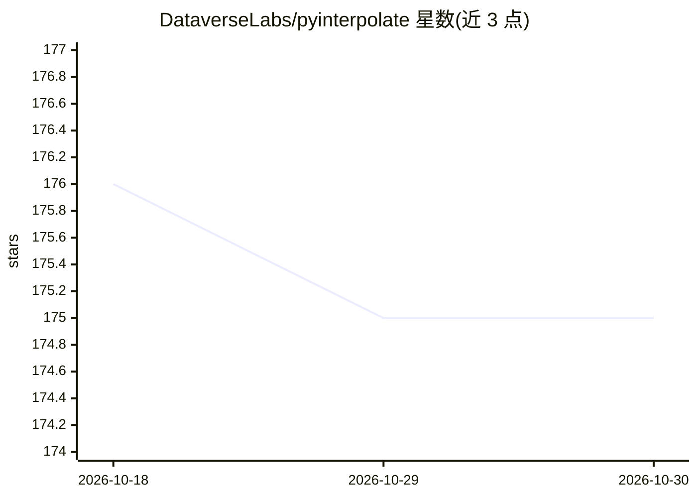

# DataverseLabs/pyinterpolate

⭐ 175 · Python · NOASSERTION · 推送 2026-05-23 · [GitHub](https://github.com/DataverseLabs/pyinterpolate) · [官网](https://pyinterpolate.readthedocs.io/en/stable/) · 个人维护

**Python 空间统计库：Kriging 插值与半变异函数分析**

面向 GIS 专家、地质学家与社会科学研究者的 Python 空间统计库，提供变异函数分析、Ordinary/Simple/Universal/Indicator Kriging、基于面数据的 Poisson Kriging（centroid、area-to-area、area-to-point）与反距离加权插值，支持从点与块数据集进行空间插值与预测及半变异函数正则化/反卷积。使用流程为：用 GeoPandas/numpy 加载数据，计算实验变异函数，拟合理论模型，插值并输出预测值与方差。需 Python>=3.10 及 geopandas 等依赖，pip 安装还需系统 libspatialindex_c.so；1.0 版本有破坏性 API 变更。

## 筛选速览

| 维度 | 判定 | 备注 |
|---|---|---|
| AI 角色 | `ai-native` | 本体是模型或模型工具 |
| 许可风险 | `none` | NOASSERTION |
| 部署形态 | `library` | 以包/库形式分发 |
| 模型依赖 | — | README 未给出锁定关系 |
| 硬件要求 | — | 无带数字的原话,不猜 |
| 安装摩擦 | `low` | 无编译、无系统依赖或容器化 |
| 成熟度 | — | 结构信号不足 |

## 能力要点

- 多种 Kriging 方法（Ordinary/Simple/Universal/Indicator/Poisson）
- 半变异函数建模、正则化与反卷积
- 面数据到点支持的空间分解（Poisson Kriging）
- 输出预测值与方差误差的不确定性分析

## 适用场景

- 对点测量数据做空间插值预测未知位置数值
- 将行政区面数据分解到点尺度做社会经济数据分析
- 空气质量等空间数据的插值与制图

## 场景标签

 · 领域:地理空间分析/科学计算

## 证据(README 行号)

> L33: Pyinterpolate is the Python library for **spatial statistics**. The package provides access to spatial statistics t
> L45: 1. *Ordinary Kriging* and *Simple Kriging* - spatial interpolation from points

## 星数曲线

2026-10-18 176 → 2026-10-30 175（-1）

---
*卡片 v1 · prompt 1.4 · 生成 2026-10-22 · 置信度 high · 依据 README sha `8b883808eed7` · [字段定义](../../DATASET.md)*
