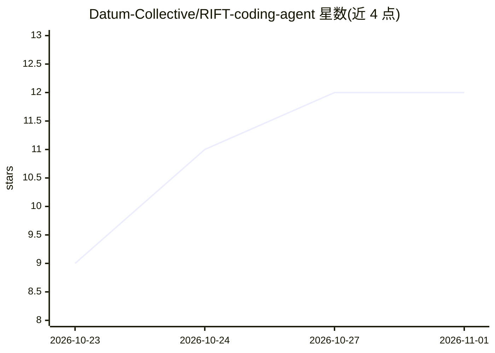

# Datum-Collective/RIFT-coding-agent

⭐ 12 · TypeScript · MIT · 推送 2026-10-28 · [GitHub](https://github.com/Datum-Collective/RIFT-coding-agent) · [官网](https://datum-collective.github.io/RIFT-coding-agent/) · 组织维护

**终端 AI 编程代理：改代码后自动跑测试/typecheck/lint 并核验自身总结**

RIFT 是 MIT 许可的 OpenCode 分支，在终端中运行的 AI 编程代理：用户用自然语言描述变更，它读代码、规划、编辑文件，随后运行项目自身的测试、类型检查与 lint 并展示真实输出；另用第二个模型将代理的总结与 git diff 对照，标记缺乏依据的声明。支持 Claude、GPT、Gemini、Llama、Mistral、DeepSeek 与本地模型，运行于 macOS/Linux/Windows。附加功能包括浏览器 UI 验证、MCP 服务器管理、Remotion 视频生成、build123d CAD 建模、深度研究（输出带引用核验的报告）与会话分享（secret Gist）。安装为单个自包含二进制（31-47MB），无需 Node/Python 构建；CAD 与深度研究功能分别需要 Python 3.10+/Python 3 与 tectonic。

## 筛选速览

| 维度 | 判定 | 备注 |
|---|---|---|
| AI 角色 | `ai-native` | 本体是模型或模型工具 |
| 许可风险 | `permissive` | MIT |
| 部署形态 | `None` |  |
| 模型依赖 | local-ok | 支持本地模型 |
| 硬件要求 | — | 无带数字的原话,不猜 |
| 安装摩擦 | `low` | 无编译、无系统依赖或容器化 |
| 成熟度 | — | 结构信号不足 |

## 能力要点

- 编辑后自动运行项目自身的 test/typecheck/lint 并展示真实输出，未运行的检查不计为通过
- 第二个模型将代理总结与 git diff 对照，标记不成立的声明
- MCP 服务器读取 .mcp.json 等既有配置并按项目管理审批
- 会话压缩前写入非模型生成的检查点与交接记录，保持目标与决策

## 适用场景

- 在终端里让 AI 代理改代码并用项目自己的测试验证
- 审查代理声称完成的工作是否被 diff 实际支撑
- 通过浏览器操作与控制台错误报告验证 UI 改动
- 生成带逐条引用核验的深度研究报告

## 场景标签

`编码 Agent` `浏览器自动化` `科研工具` · 领域:效率与自动化

## 证据(README 行号)

> L21: RIFT is a free, MIT-licensed AI coding agent. You run `rift` inside a project, describe a change in
> L23: coding agents leave to you: it runs the project's own tests, typechecker and linter and shows you

## 星数曲线

2026-10-23 9 → 2026-11-01 12（+3）

---
*卡片 v1 · prompt 1.4 · 生成 2026-11-01 · 置信度 high · 依据 README sha `eb9dff6e2bba` · [字段定义](../../DATASET.md)*
