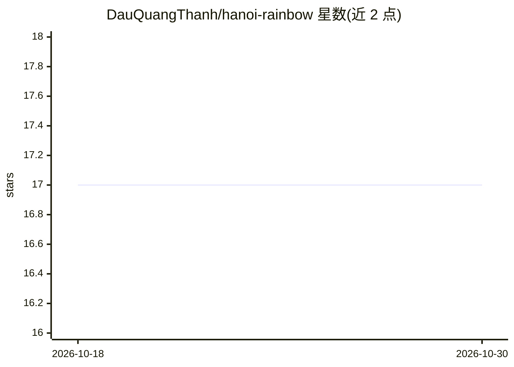

# DauQuangThanh/hanoi-rainbow

⭐ 17 · Python · MIT · 推送 2026-01-23 · [GitHub](https://github.com/DauQuangThanh/hanoi-rainbow) · 个人维护

**面向 AI 编程代理的规格驱动开发工作流框架**

Hanoi Rainbow 是一套 Spec-Driven Development 框架：通过 rainbow CLI 初始化项目，向 AI 编程代理（Claude Code、Gemini CLI、Codex CLI、Cursor 等 19 种）注入 15 个 /rainbow.* 斜杠命令，把开发流程组织为建立原则→写规格→技术设计→任务拆分→实现→测试的步骤；所有命令完成后自动生成语义化 git 提交。同时区分 Greenfield（新项目，8 命令全流程）与 Brownfield（存量项目，先 assess-context 再精简流程）两种模式，CLI 支持多代理选择、GitHub token、跳过 git 初始化等选项。以 uv 从 GitHub 源码安装。

## 筛选速览

| 维度 | 判定 | 备注 |
|---|---|---|
| AI 角色 | `ai-ecosystem` | LLM/agent 周边工具 |
| 许可风险 | `permissive` | MIT |
| 部署形态 | `None` |  |
| 模型依赖 | — | README 未给出锁定关系 |
| 硬件要求 | — | 无带数字的原话,不猜 |
| 安装摩擦 | `medium` | 含编译或系统依赖之一 |
| 成熟度 | — | 结构信号不足 |

## 能力要点

- 15 个 /rainbow.* 斜杠命令覆盖规格、设计、任务、实现、E2E 测试全流程
- 支持 19 种 AI 编程代理（Claude Code、Gemini CLI、Codex CLI、Cursor、Copilot 等）
- 区分 Greenfield 新项目与 Brownfield 存量项目两种工作流
- 命令完成时自动生成语义化前缀的 git 提交

## 适用场景

- 新项目按规格驱动流程让 AI 代理逐步实现功能
- 在存量代码库中先分析上下文再以一致风格添加功能
- 把任务清单转换为 GitHub issues 或 Azure DevOps 工作项

## 场景标签

`工作流自动化` · 领域:效率与自动化

## 证据(README 行号)

> L163: ## 🤖 Supported AI Agents
> L223: ### Available Slash Commands

## 星数曲线

2026-10-18 17 → 2026-10-30 17（+0）

---
*卡片 v1 · prompt 1.4 · 生成 2026-10-30 · 置信度 high · 依据 README sha `61a04180a4b7` · [字段定义](../../DATASET.md)*
