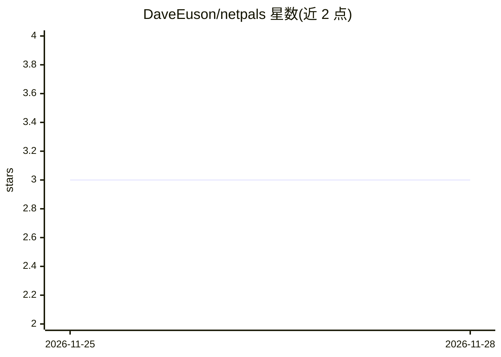

# DaveEuson/netpals

⭐ 3 · JavaScript · NOASSERTION · 推送 2026-11-23 · [GitHub](https://github.com/DaveEuson/netpals) · 个人维护

**复古风格好友列表桌面应用，AI 人设角色主动给你发 IM**

以 2003 年即时通讯好友列表为形态的桌面应用：好友是具有性格与所处年份设定的 AI 人设，按自己的节奏向你发消息、进入 idle/away 状态、记住你说过的话。语言模型驱动对话，默认使用本机运行的模型（自动发现 Ollama 或 LM Studio，可代为下载模型），也可选配 OpenRouter、Claude、ChatGPT 或 Gemini 的 API key。本地优先：无账号、无服务器、无分析统计，对话存于本机。提供 Windows 安装包与 macOS dmg。

## 筛选速览

| 维度 | 判定 | 备注 |
|---|---|---|
| AI 角色 | `ai-native` | 本体是模型或模型工具 |
| 许可风险 | `none` | NOASSERTION |
| 部署形态 | `desktop` | 安装包/桌面程序 |
| 模型依赖 | local-ok | 支持本地模型 |
| 硬件要求 | — | 无带数字的原话,不猜 |
| 安装摩擦 | `low` | 无编译、无系统依赖或容器化 |
| 成熟度 | — | 结构信号不足 |

## 能力要点

- 好友为 AI 人设，主动发消息、记忆并按所处年代使用语言风格
- 自动发现本机 Ollama/LM Studio 并可代为下载模型
- RigMatch 在本机硬件上试跑模型并推荐合适的一个
- 可选接入 OpenRouter/Claude/ChatGPT/Gemini API

## 适用场景

- 在本机本地运行模型与 AI 人设好友聊天
- 怀旧 2000 年代即时通讯界面的桌面陪伴应用
- 为好友配置日历与天气，让其了解你的一天

## 场景标签

`聊天机器人` · 领域:对话与助手

## 证据(README 行号)

> L3: A 2003-style buddy list where the buddies are AI personas who IM you through the day.
> L35: Netpals needs a language model to write your buddies' lines. The free way runs it on your computer. OpenRouter,

## 星数曲线

2026-11-25 3 → 2026-11-28 3（+0）

---
*卡片 v1 · prompt 1.4 · 生成 2026-11-24 · 置信度 high · 依据 README sha `2051db9c3b6d` · [字段定义](../../DATASET.md)*
