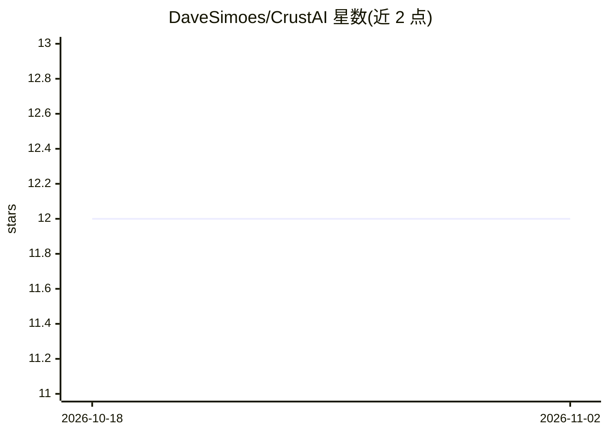

# DaveSimoes/CrustAI

⭐ 12 · JavaScript · MIT · 推送 2026-05-23 · [GitHub](https://github.com/DaveSimoes/CrustAI) · 个人维护

**本地私有 AI 助手：接入 Telegram/Discord/WhatsApp/Slack 四平台聊天**

基于 Node.js 的自托管 AI 聊天助手，通过 Ollama 在本地运行 LLM（tinyllama/phi3/llama3.2/mistral 等），以适配器架构同时接入 Telegram、Discord、WhatsApp 和 Slack 四个消息平台。提供长期记忆（SQLite 存储用户事实）、人格配置、离线语音模式（pt-BR）、REST API 与模型基准测试脚本，支持 Docker 部署。运行需 Node.js ≥ 20 与已安装的 Ollama，并需平台 token；无遥测、无外部 API 调用。

## 筛选速览

| 维度 | 判定 | 备注 |
|---|---|---|
| AI 角色 | `ai-native` | 本体是模型或模型工具 |
| 许可风险 | `permissive` | MIT |
| 部署形态 | `library` | 以包/库形式分发 |
| 模型依赖 | local-ok | 支持本地模型 |
| 硬件要求 | — | 无带数字的原话,不猜 |
| 安装摩擦 | `low` | 无编译、无系统依赖或容器化 |
| 成熟度 | — | 结构信号不足 |

## 能力要点

- 四消息平台同时接入（Telegram/Discord/WhatsApp/Slack）
- Ollama 本地推理，支持 tinyllama 至 mistral 等多种模型
- 长期记忆持久化到本地 SQLite，跨会话保留用户事实
- REST API、Docker 部署与模型基准测试脚本

## 适用场景

- 在 Telegram/Discord 等平台用私有本地模型聊天，数据不出本机
- 自托管一个可定制人格、带长期记忆的个人 AI 助手
- 通过 REST API 将助手集成进自己的工具和自动化流程

## 场景标签

`AI 助手` `聊天机器人` `Agent 记忆` · 领域:Agent 开发

## 证据(README 行号)

> L18: > **Chat with your own AI on Telegram, Discord, WhatsApp, and Slack — no data ever leaves your machine.**
> L51: |🧠 **Powered by Ollama**|Use llama3.2, mistral, phi3, tinyllama and any model you choose|
> L123: 3. **Ollama LLM** — Runs any compatible model locally. No network calls. No rate limits. No billing.

## 星数曲线

2026-10-18 12 → 2026-11-02 12（+0）

---
*卡片 v1 · prompt 1.4 · 生成 2026-11-01 · 置信度 high · 依据 README sha `8aedd7f445d1` · [字段定义](../../DATASET.md)*
