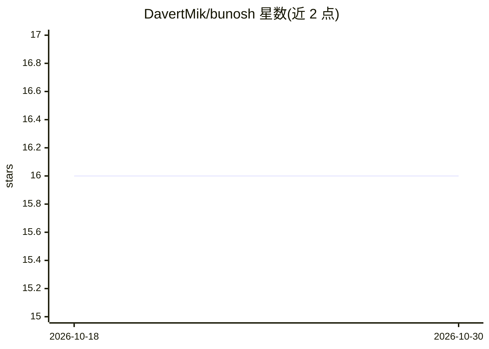

# DavertMik/bunosh

⭐ 16 · JavaScript · 推送 2026-10-21 · [GitHub](https://github.com/DavertMik/bunosh) · [官网](https://buno.sh) · 个人维护

**用 JavaScript 编写 CLI 任务的任务运行器**

基于 Bun/JavaScript 的命令行任务运行器：将 Bunoshfile.js 中导出的函数自动转换为 CLI 命令，函数参数映射为命令行参数与选项，支持命名空间组织（Bunoshfile.<ns>.js）。内置 exec/shell/fetch/ask 等全局任务工具、task 包装与追踪、assert 前置条件守卫、并行执行与失败控制。提供 macOS/Linux/Windows 单文件可执行程序，也可经 bun/npm 全局安装。文档目录中列有 AI Integration（内置 AI 支持）章节。

## 筛选速览

| 维度 | 判定 | 备注 |
|---|---|---|
| AI 角色 | `ai-enhanced` | 去掉 AI 部分产品仍成立 |
| 许可风险 | `none` | — |
| 部署形态 | `desktop` | 安装包/桌面程序 |
| 模型依赖 | — | README 未给出锁定关系 |
| 硬件要求 | — | 无带数字的原话,不猜 |
| 安装摩擦 | `low` | 无编译、无系统依赖或容器化 |
| 成熟度 | — | 结构信号不足 |

## 能力要点

- 导出函数自动转换为 CLI 命令，参数映射为选项
- 内置 exec/shell/fetch/task/assert 等任务工具
- 多 Bunoshfile 命名空间组织与并行执行
- 单文件可执行程序，无需 Node.js 或 Bun

## 适用场景

- 把项目部署、构建等重复操作写成可复用的 CLI 命令
- 用 JavaScript 替代 bash 脚本实现跨平台自动化任务
- 在命令中执行前置条件检查并控制失败行为

## 场景标签

`工作流自动化` · 领域:效率与自动化

## 证据(README 行号)

> L5:  A task runner for JavaScript. Transform functions into CLI commands.
> L378: - **AI Integration** — Built-in AI support

## 星数曲线

2026-10-18 16 → 2026-10-30 16（+0）

---
*卡片 v1 · prompt 1.4 · 生成 2026-10-30 · 置信度 low · 依据 README sha `9f68d1124cb1` · [字段定义](../../DATASET.md)*
