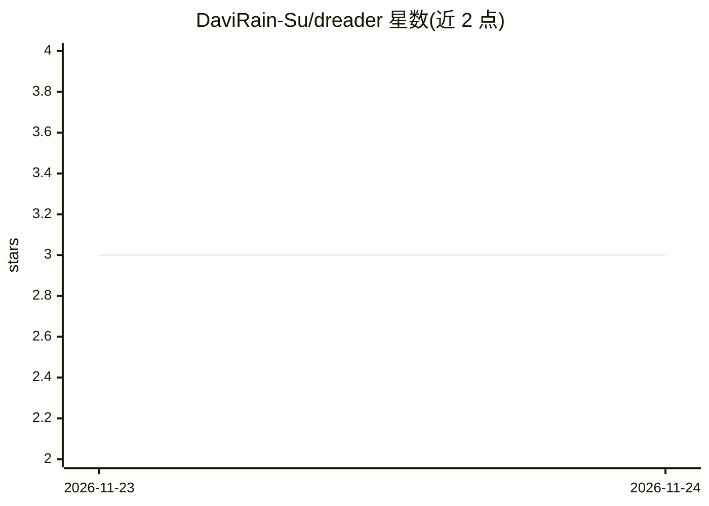

# DaviRain-Su/dreader

⭐ 3 · Swift · NOASSERTION · 推送 2026-11-07 · [GitHub](https://github.com/DaviRain-Su/dreader) · 个人维护 · 中文 README

**原生 macOS 电子书阅读器，内置本地优先的 AI 阅读伴侣**

面向严肃读者的原生 macOS 阅读器，支持 EPUB、MOBI/AZW3、Markdown、PDF，提供中文竖排排版、繁简转换、双语对照、批注笔记与间隔重复复习。AI 部分通过本地 agent 运行时 pi 以 RPC 协议接入：选中段落可发起提问、解释、摘要、翻译，并提供章节导读与四种阅读人格；模型选择与 API key 保存在 pi 中，应用本身不存 key。预编译包为 Apple Silicon，Intel 用户需源码编译；无 pi 时除 AI 外功能均可离线使用。

## 筛选速览

| 维度 | 判定 | 备注 |
|---|---|---|
| AI 角色 | `ai-enhanced` | 去掉 AI 部分产品仍成立 |
| 许可风险 | `none` | NOASSERTION |
| 部署形态 | `None` |  |
| 模型依赖 | — | README 未给出锁定关系 |
| 硬件要求 | — | 无带数字的原话,不猜 |
| 安装摩擦 | `low` | 无编译、无系统依赖或容器化 |
| 成熟度 | — | 结构信号不足 |

## 能力要点

- 选中段落触发 Ask AI / 解释 / 摘要 / 翻译的浮动工具栏
- AI 推理经由本地 agent 运行时 pi，四条独立 RPC 通道（聊天/导读/翻译×2）
- 中文竖排（writing-mode: vertical-rl）与 GB18030/Big5/UTF-8 编码检测
- 内置 MCP 服务器 dreader-mcp，向 Claude Desktop/Claude Code 暴露书架、批注与阅读统计

## 适用场景

- 阅读中文竖排古籍或多格式电子书并做批注复习
- 选段让 AI 解释隐喻、典故或生成章节导读
- 整书批量生成双语对照阅读
- 通过 MCP 让本地 Claude 查询自己的批注和阅读数据

## 场景标签

`文档问答` · 领域:知识与检索

## 证据(README 行号)

> L14: **DReader** is a native **macOS e-book reader** for people who read seriously. It opens **EPUB, MOBI/AZW3, Markdown
> L76: **How the AI runs.** All inference goes through a single local agent runtime, `pi`, which DReader drives over a per
> L138: DReader detects `pi` on `PATH` automatically. Without it, everything except AI features still works.

## 星数曲线

2026-11-23 3 → 2026-11-24 3（+0）

---
*卡片 v1 · prompt 1.4 · 生成 2026-11-23 · 置信度 high · 依据 README sha `e94cb6df5cdb` · [字段定义](../../DATASET.md)*
