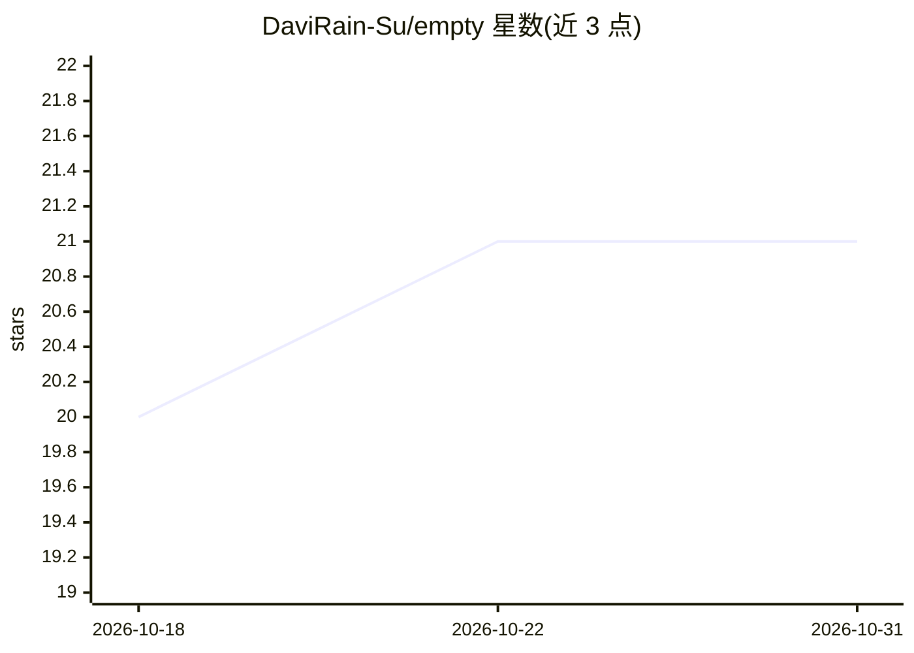

# DaviRain-Su/empty

⭐ 21 · Swift · MIT · 推送 2026-06-21 · [GitHub](https://github.com/DaviRain-Su/empty) · [官网](https://empty-78c.pages.dev) · 个人维护 · 中文 README

**带防剧透 AI 伴读的 EPUB/PDF 本地优先阅读应用**

SwiftUI 原生 EPUB/PDF 阅读器（macOS 深读工作台 + iOS/iPadOS 随身端），核心机制是所有 AI 功能（章节回顾、翻译、词汇、闪卡、跨书记忆）在数据层仅使用已读文本以防剧透。AI 默认走 Apple Intelligence 本地模型，可选 BYOK 云端（OpenAI 兼容/Anthropic 兼容）。支持高亮批注、间隔重复词汇复习、思维链接与本地嵌入。macOS 提供 .dmg 下载（未签名），或用 Xcode 从源码构建，需 Xcode 26+。

## 筛选速览

| 维度 | 判定 | 备注 |
|---|---|---|
| AI 角色 | `ai-enhanced` | 去掉 AI 部分产品仍成立 |
| 许可风险 | `permissive` | MIT |
| 部署形态 | `desktop` | 安装包/桌面程序 |
| 模型依赖 | — | README 未给出锁定关系 |
| 硬件要求 | — | 无带数字的原话,不猜 |
| 安装摩擦 | `medium` | 含编译或系统依赖之一 |
| 成熟度 | — | 结构信号不足 |

## 能力要点

- 所有 AI 功能在数据层过滤未读文本，实现防剧透
- 默认 Apple Intelligence 本地模型，可选 BYOK 云端（密钥存 Keychain）
- 原生 SwiftUI 块模型渲染 EPUB，不经 WebView；PDF 走 PDFKit
- 跨书 ReaderMemory、本地嵌入与 Ebbinghaus 间隔重复词汇复习

## 适用场景

- 长篇小说阅读时获得不含结局剧透的 AI 回顾与解释
- 外语阅读中做段落翻译、词汇查询与闪卡复习
- 跨多本书积累笔记与主题链接并本地保存数据

## 场景标签

`知识库管理` · 领域:知识与检索

## 证据(README 行号)

> L22: Most AI reading tools summarize the *whole* book and accidentally spoil the ending. **Empty only uses what you have
> L71: |**On-Device (default)**|Apple Foundation Models — local, free, private.|

## 星数曲线

2026-10-18 20 → 2026-10-31 21（+1）

---
*卡片 v1 · prompt 1.4 · 生成 2026-10-28 · 置信度 high · 依据 README sha `55e5aeb418c7` · [字段定义](../../DATASET.md)*
