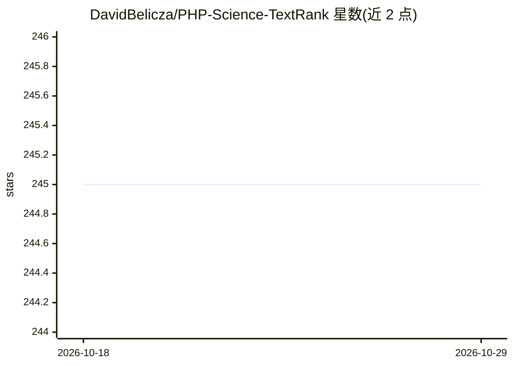

# DavidBelicza/PHP-Science-TextRank

⭐ 245 · PHP · MIT · 推送 2026-08-11 · [GitHub](https://github.com/DavidBelicza/PHP-Science-TextRank) · [官网](https://php.science/textrank/) · 个人维护

**PHP 实现的 TextRank 自动文本摘要与关键词提取库**

以 PHP 语言实现 TextRank 算法的库，MIT 许可。处理流程为：抽取句子、去停用词、按词匹配计数赋整数值、加权、归一化得分并排序，从原文中提取重要句子与关键词，属于低成本抽取式摘要，无需模型训练或大量算力。README 提出其可作为 GPT 模型的预处理器以缩减输入文本、降低资源消耗。通过 Composer 安装，附带英文停用词工具与示例测试，贡献开发可用 docker-compose 环境。

## 筛选速览

| 维度 | 判定 | 备注 |
|---|---|---|
| AI 角色 | `ai-native` | 本体是模型或模型工具 |
| 许可风险 | `permissive` | MIT |
| 部署形态 | `self-host` | docker 或自建部署 |
| 模型依赖 | — | README 未给出锁定关系 |
| 硬件要求 | — | 无带数字的原话,不猜 |
| 安装摩擦 | `low` | 无编译、无系统依赖或容器化 |
| 成熟度 | — | 结构信号不足 |

## 能力要点

- PHP 实现的 TextRank 抽取式文本摘要算法
- 流程覆盖分句、去停用词、加权、归一化与按得分排序
- 提供英文停用词工具与多个使用示例
- 可用于在调用 GPT 模型前压缩文本以降低资源消耗

## 适用场景

- 在 PHP 项目中对长文本文档生成抽取式摘要
- 从文章中提取关键句子和关键词
- 作为 LLM 输入的预处理步骤以缩减文本体积

## 场景标签

`AI 写作` · 领域:内容生成

## 证据(README 行号)

> L16: This source code is an implementation of TextRank algorithm in PHP programming language, under MIT licence.
> L20: input using vast resources while TextRank is a cost-efficient/low-cost text extraction algorithm. TextRank algorith

## 星数曲线

2026-10-18 245 → 2026-10-29 245（+0）

---
*卡片 v1 · prompt 1.4 · 生成 2026-10-22 · 置信度 mid · 依据 README sha `a60a3d4ab9a6` · [字段定义](../../DATASET.md)*
