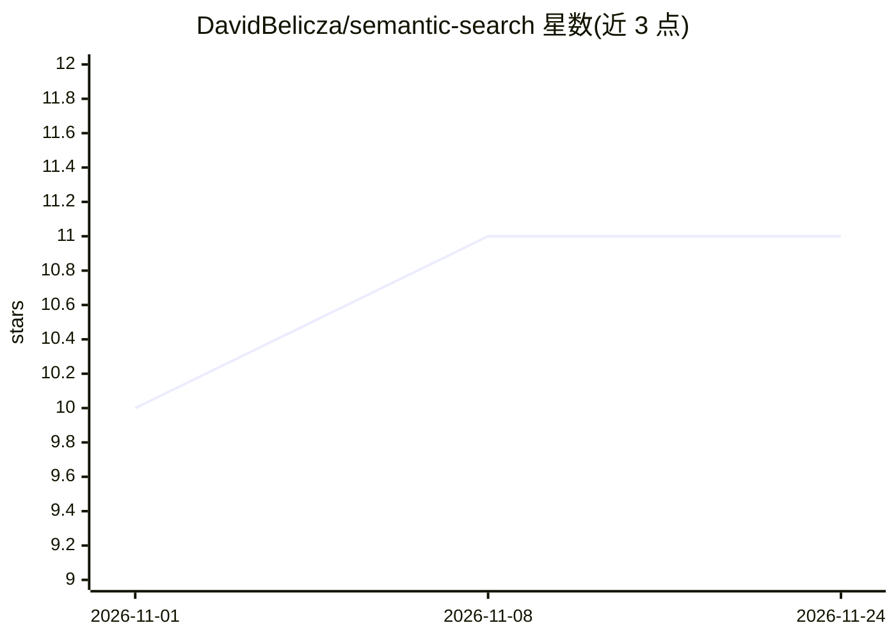

# DavidBelicza/semantic-search

⭐ 11 · Go · MIT · 推送 2026-08-18 · [GitHub](https://github.com/DavidBelicza/semantic-search) · 个人维护

**Go 语义搜索库：把 PDF/Markdown/代码切块嵌入向量库供含义检索**

一个用 Go 编写的语义搜索库：递归扫描目录中的 PDF、Markdown、代码、DOCX、HTML、字幕、电子书等文件，按类型策略切块并生成向量，存入嵌入式 SQLite（磁盘/内存）或 PostgreSQL+pgvector，支持精确 kNN 与服务端 HNSW 索引。嵌入通过任意 OpenAI 兼容协议的 embedding 服务（LM Studio、Ollama、llama.cpp 等）完成，内置 6 个预定义嵌入模型定义。客户端场景需 C 编译器做 cgo 构建；纯 Postgres 构建无需 cgo。以 Go 库形式提供，examples/ 含 4 个可运行示例。

## 筛选速览

| 维度 | 判定 | 备注 |
|---|---|---|
| AI 角色 | `ai-native` | 本体是模型或模型工具 |
| 许可风险 | `permissive` | MIT |
| 部署形态 | `self-host` | docker 或自建部署 |
| 模型依赖 | local-ok | 支持本地模型 |
| 硬件要求 | — | 无带数字的原话,不猜 |
| 安装摩擦 | `low` | 无编译、无系统依赖或容器化 |
| 成熟度 | — | 结构信号不足 |

## 能力要点

- 支持 9 类文件格式的切块策略（Markdown 按标题、代码按函数/类、PDF 按字号识别标题等）
- 双存储后端：嵌入式 SQLite（磁盘/内存）与 PostgreSQL+pgvector（kNN/HNSW）
- 嵌入服务走 OpenAI 兼容协议，内置 Gemma/Nomic/E5/BGE/Qwen/Mxbai 模型定义
- SearchConfig 支持任务类型、最小相关度、文档与分块数量上限配置

## 适用场景

- 给桌面/移动应用内置个人知识库的语义搜索
- 在终端对本地文件和笔记做语义检索
- 为网店或产品目录搭建服务端含义搜索知识库

## 场景标签

`语义搜索` `向量数据库` · 领域:知识与检索

## 证据(README 行号)

> L12:  It recursively indexes PDF, Markdown, code, and many other file types in a directory, then chunks them and stores 
> L62: 5. **Search**: embed the query and rank chunks by vector distance using exact k-nearest-neighbor (kNN) search, comp
> L86: - **Every use case** needs an **OpenAI-compatible embedding server** (it does not mean actual OpenAI models): on yo

## 星数曲线

2026-11-01 10 → 2026-11-24 11（+1）

---
*卡片 v1 · prompt 1.4 · 生成 2026-11-19 · 置信度 mid · 依据 README sha `46737f01af71` · [字段定义](../../DATASET.md)*
