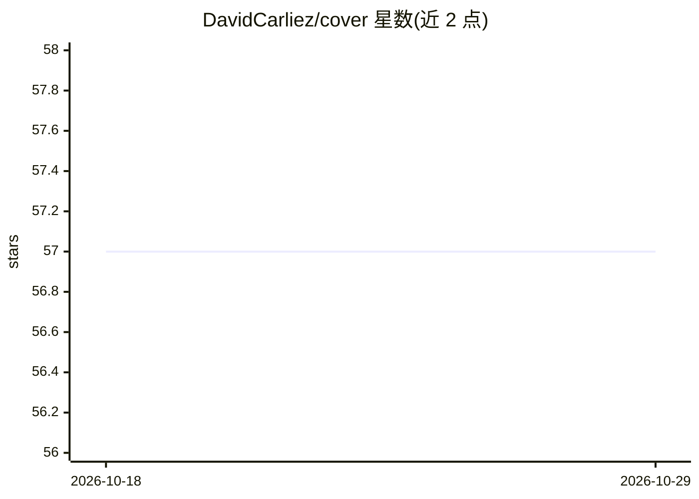

# DavidCarliez/cover

⭐ 57 · Go · Apache-2.0 · 推送 2026-10-08 · [GitHub](https://github.com/DavidCarliez/cover) · 个人维护

**面向 AI 编程代理的双向隐私代理，防止敏感数据外泄**

Cover 是一个运行在本机的双向隐私代理，位于 AI 编程代理与云端 LLM 之间：请求发出前在本地将命中的敏感值替换为确定性的仿真替身，响应（含 SSE 流式）返回时再把假值还原为真值，使代理和工具继续使用真实环境。策略支持 allow/placeholder/pseudonymize/mask/redact/block，内置正则检测 AWS/GCP 密钥、JWT、SSN、信用卡等，另提供可选的本地 llama.cpp 语义检测。安装脚本下载预构建二进制并校验 SHA-256，支持 Linux/macOS/Windows，也可 Go 交叉编译。限制：内置检测不跨行匹配，重启后内存中的映射丢失。

## 筛选速览

| 维度 | 判定 | 备注 |
|---|---|---|
| AI 角色 | `ai-ecosystem` | LLM/agent 周边工具 |
| 许可风险 | `permissive` | Apache-2.0 |
| 部署形态 | `desktop` | 安装包/桌面程序 |
| 模型依赖 | local-ok | 支持本地模型 |
| 硬件要求 | — | 无带数字的原话,不猜 |
| 安装摩擦 | `low` | 无编译、无系统依赖或容器化 |
| 成熟度 | — | 结构信号不足 |

## 能力要点

- 双向伪匿名化：请求前替换敏感值、响应中还原，覆盖流式 SSE
- 六种策略动作：allow/placeholder/pseudonymize/mask/redact/block
- 确定性仿真替身生成器：IP/域名/邮箱/UUID/IBAN/电话等 16 类
- cover inspect/doctor/monitor 等本地诊断与元数据审计命令

## 适用场景

- 使用 Claude Code/Codex/Cursor 等云端编程代理时防止密钥与内部基础设施信息外泄
- 企业内对发往 LLM 的请求做 DLP 级脱敏与阻断
- 在不破坏代理工作流的前提下保留可逆的上下文连贯性

## 场景标签

`网络安全` · 领域:学习与行业

## 证据(README 行号)

> L16: Cover is a bidirectional privacy proxy for AI coding agents. It replaces
> L29: Supported clients include **Codex**, **Claude Code**, **Cursor**, **Pi / Oh My

## 星数曲线

2026-10-18 57 → 2026-10-29 57（+0）

---
*卡片 v1 · prompt 1.4 · 生成 2026-10-24 · 置信度 high · 依据 README sha `c233a75b0291` · [字段定义](../../DATASET.md)*
