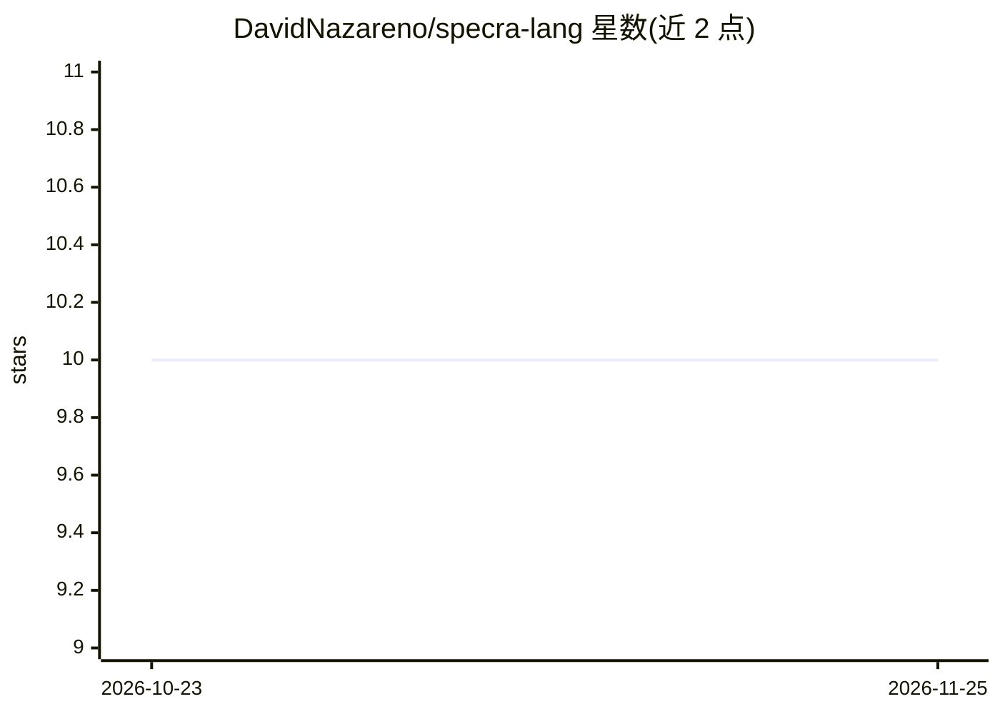

# DavidNazareno/specra-lang

⭐ 10 · TypeScript · MIT · 推送 2026-06-05 · [GitHub](https://github.com/DavidNazareno/specra-lang) · [官网](https://davidnazareno.github.io/specra-lang/) · 个人维护

**面向 agent 工作流的契约驱动 AI 编码与验证语言**

Specra 是一种 intent-first 的规范语言（.scl.md），让人与 AI agent 在编辑大型代码库时以紧凑契约文件为单一事实来源，记录实体、操作、期望与约束。CLI 提供 init/check/refresh/proof/verify 等命令，生成面向 agent 的紧凑产物（ctx.json、plan.json、SQLite 索引），并对 agent 观测到的行为与契约做核对。声明处于早期实验阶段，自动从 Next.js 测试提取结果尚未实现，验证结果由 agent 填入 proof.json。

## 筛选速览

| 维度 | 判定 | 备注 |
|---|---|---|
| AI 角色 | `ai-ecosystem` | LLM/agent 周边工具 |
| 许可风险 | `permissive` | MIT |
| 部署形态 | `library` | 以包/库形式分发 |
| 模型依赖 | — | README 未给出锁定关系 |
| 硬件要求 | — | 无带数字的原话,不猜 |
| 安装摩擦 | `low` | 无编译、无系统依赖或容器化 |
| 成熟度 | `idea` | |

## 能力要点

- Markdown-first 的 .scl.md 规范语言与解析/校验器
- 生成面向 agent 的紧凑产物（ctx.json、plan.json、SQLite 状态索引）
- 对 agent 观测行为做契约核对的基本期望验证器
- 支持为 OpenCode、Claude Code、Codex 安装本地或全局 agent 指引

## 适用场景

- 以契约文件约束 AI agent 对代码库的修改范围与行为
- 在仓库内定义实体、操作与期望并验证 agent 填报的测试结果
- 为多个 AI 编码 agent 统一安装本地规范指引

## 场景标签

`编码 Agent` · 领域:编码与开发

## 证据(README 行号)

> L3: Specra is an intent-first language for AI-assisted software development.
> L28: - a CLI
> L179: - OpenCode via `opencode`

## 星数曲线

2026-10-23 10 → 2026-11-25 10（+0）

---
*卡片 v1 · prompt 1.4 · 生成 2026-11-20 · 置信度 high · 依据 README sha `b701f5f703f2` · [字段定义](../../DATASET.md)*
