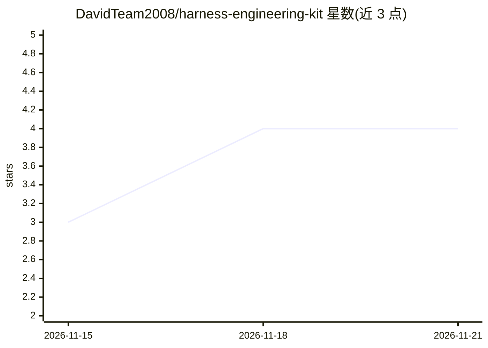

# DavidTeam2008/harness-engineering-kit

⭐ 4 · Python · MIT · 推送 2026-11-16 · [GitHub](https://github.com/DavidTeam2008/harness-engineering-kit) · [官网](https://github.com/DavidTeam2008/harness-engineering-kit/blob/main/docs/adoption.md) · 个人维护 · 中文 README

**给 AI Coding Agent 项目生成可验收规则、门禁与证据链的脚手架**

Harness Engineering 项目管理工具（治理层），按 Instructions / State / Verification / Scope / Session Lifecycle 五子系统，把规则、状态与证据落成仓库文件、静态门禁与命令。核心机制：证据三值（PASS/FAIL/UNVERIFIED）+ JUnit XML 独立重算 + commit/clean-tree 绑定、计划 scope.allow/deny 与 git status 交叉核对、harness-selftest 负向注入验证门禁会红。提供 npx 入口 skill、CLI 脚手架与提示词兜底三条接入路径，支持新项目初始化与存量项目改造（brownfield 七步法）。产物可整目录删除，不是框架或运行时依赖。

## 筛选速览

| 维度 | 判定 | 备注 |
|---|---|---|
| AI 角色 | `ai-ecosystem` | LLM/agent 周边工具 |
| 许可风险 | `permissive` | MIT |
| 部署形态 | `library` | 以包/库形式分发 |
| 模型依赖 | — | README 未给出锁定关系 |
| 硬件要求 | — | 无带数字的原话,不猜 |
| 安装摩擦 | `medium` | 含编译或系统依赖之一 |
| 成熟度 | — | 结构信号不足 |

## 能力要点

- 证据三值 + JUnit XML 重算 + commit 绑定，'无 evidence id 即未验证'
- 计划 scope.allow/deny 与 git status 交叉核对拦截越界修改
- harness-selftest 负向注入（M1–M9）证明门禁会红
- 三条接入路径：npx skill / CLI 脚手架 / 提示词兜底

## 适用场景

- 给用 AI Agent 长期维护的项目搭建可复核的过程门禁
- 存量项目文档与过程记录失控时做只读盘点后改造
- 跨会话、跨人、跨 Agent 交接时不把状态留在聊天记录里
- 给'Agent 说完成了'加一道可复核闸门

## 场景标签

`提示工程` · 领域:Agent 开发

## 证据(README 行号)

> L3: > **给 AI Coding Agent 用的 Harness Engineering 项目管理工具**：按 **Instructions / State / Verification / Scope / Session Life
> L18: Harness Engineering 的工作定义：**Agent = Model + Harness**。模型能力在变，但"指令、状态、验证、作用域、会话生命周期"这些模型之外的工程设施决定能力兑现率。harness-kit 把
> L53: - 想按 **Harness Engineering 五子系统**搭建或改造项目、并用 AI Coding Agent（DeepSeek Harness、Claude Code、Codex、Cursor、自研 Agent）长期维护

## 星数曲线

2026-11-15 3 → 2026-11-21 4（+1）

---
*卡片 v1 · prompt 1.4 · 生成 2026-11-21 · 置信度 high · 依据 README sha `1664ac8a5dc9` · [字段定义](../../DATASET.md)*
