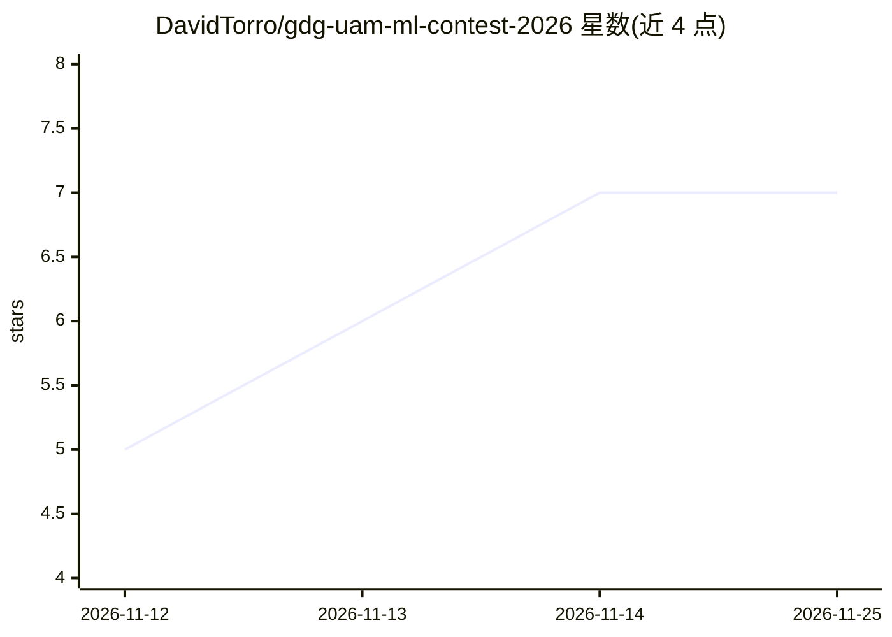

# DavidTorro/gdg-uam-ml-contest-2026

⭐ 7 · Python · MIT · 推送 2026-11-12 · [GitHub](https://github.com/DavidTorro/gdg-uam-ml-contest-2026) · [官网](https://gdg-ml.davidtorro.com) · 个人维护 · 中文 README

**ML 竞赛提交项目：CPU 推理的 8 类多通道时序 1D CNN 分类**

GDG UAM ML Contest 2026 的个人参赛提交：将四通道 256 步长时间序列分为 8 类。模型为导出至 ONNX 的 1D CNN（含类别 6 的 logit 调整），推理路径仅依赖 ONNX Runtime 单 CPU 线程与 Numba 编译的预处理，通过复用缓冲区与 I/O Binding 降低单样本开销，不需要 PyTorch 或训练数据。README 提供 macOS/Linux/Windows 从源码克隆验证的完整命令，以及一个在 Colab CPU 运行时中执行官方 harness 检查的笔记本；官方 demo 报告 400 样本中 338 个正确（84.5%）。ONNX 权重文件不含重用许可，仅限评估本参赛作品。

## 筛选速览

| 维度 | 判定 | 备注 |
|---|---|---|
| AI 角色 | `ai-native` | 本体是模型或模型工具 |
| 许可风险 | `permissive` | MIT |
| 部署形态 | `desktop` | 安装包/桌面程序 |
| 模型依赖 | — | README 未给出锁定关系 |
| 硬件要求 | — | 无带数字的原话,不猜 |
| 安装摩擦 | `low` | 无编译、无系统依赖或容器化 |
| 成熟度 | — | 结构信号不足 |

## 能力要点

- 1D CNN 导出为 ONNX，单 CPU 线程推理，默认路径无需 PyTorch 与训练数据
- Numba 编译预处理、缓冲区复用与 ONNX Runtime I/O Binding 降低单样本开销
- 官方 demo 400 样本 338 正确（84.5%），Colab 重复 demo 得分 120.576
- 提供 macOS/Linux/Windows/Colab 四套完整验证流程

## 适用场景

- 复现该竞赛提交在官方 harness 上的精度与吞吐评分
- 在本地 CPU 环境或 Colab 中验证模型文件与依赖
- 参考其 CPU 推理路径的预处理与缓冲区组织方式

## 场景标签

 · 领域:机器学习/时间序列分类

## 证据(README 行号)

> L17: My individual entry for the GDG UAM ML Contest 2026. The task is to classify a four-channel, 256-step time series i
> L21: `model.py` loads `models/exp033.sesgo.onnx` by default. It is a 1D CNN exported to ONNX, including the class-6 logi

## 星数曲线

2026-11-12 5 → 2026-11-25 7（+2）

---
*卡片 v1 · prompt 1.4 · 生成 2026-11-20 · 置信度 high · 依据 README sha `c5ad023ec49a` · [字段定义](../../DATASET.md)*
