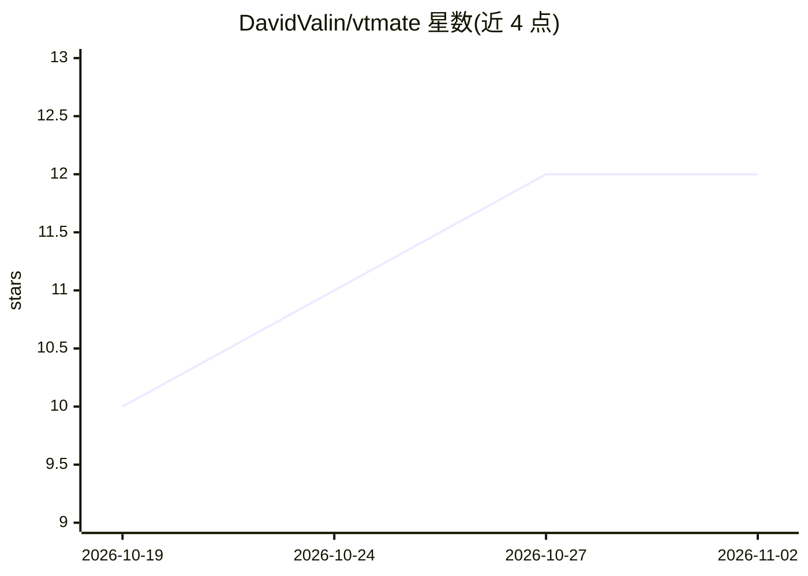

# DavidValin/vtmate

⭐ 12 · Rust · NOASSERTION · 推送 2026-09-22 · [GitHub](https://github.com/DavidValin/vtmate) · [官网](https://github.com/DavidValin/vtmate) · 个人维护

**终端本地语音 AI 对话工具：41 语言低延迟语音交互**

在终端中运行的语音 AI 对话系统：集成 whisper 语音识别与 Kokoro/Supertonic TTS，无需外部安装即可语音对话；支持 LIVE 实时对话（可语音打断）、PTT、双 Agent 辩论、后台模式、文本朗读与会话导出（音频/文本）。LLM 端默认 ollama，也可用 llama-server、OpenAI 兼容服务器或 OpenAI/Anthropic/Google 等托管服务；支持 CUDA/Vulkan/Metal 加速，macOS/Linux/Windows 均有构建版本，可通过 installer.sh 安装。

## 筛选速览

| 维度 | 判定 | 备注 |
|---|---|---|
| AI 角色 | `ai-native` | 本体是模型或模型工具 |
| 许可风险 | `none` | NOASSERTION |
| 部署形态 | `None` |  |
| 模型依赖 | local-ok | 支持本地模型 |
| 硬件要求 | — | 无带数字的原话,不猜 |
| 安装摩擦 | `medium` | 含编译或系统依赖之一 |
| 成熟度 | — | 结构信号不足 |

## 能力要点

- 集成 whisper STT 与 Kokoro/Supertonic TTS，无需外部安装
- 41 种语言，LIVE 实时对话支持语音/键盘中断
- 双 Agent 辩论模式、后台模式、Read 模式
- 支持本地（ollama/llama-server/OpenAI 兼容）与多家托管 provider
- macOS/Linux/Windows 提供 CPU/CUDA/Vulkan/Metal 构建

## 适用场景

- 在终端与本地模型进行低延迟语音对话
- 后台语音助手：朗读文章、语音输入、日常辅助
- 让两个 AI Agent 辩论并参与其中

## 场景标签

`语音 Agent` · 领域:对话与助手

## 证据(README 行号)

> L5:  Local voice AI conversations in your terminal.
> L45: - 📌 Integrated `whisper` speech recognition system (no external intallation required)
> L49: - 📌 Use any gguf model from huggingface.com (using llama-server), any ollama model, or a hosted provider (OpenAI, A

## 星数曲线

2026-10-19 10 → 2026-11-02 12（+2）

---
*卡片 v1 · prompt 1.4 · 生成 2026-11-01 · 置信度 high · 依据 README sha `68be2aaa30f5` · [字段定义](../../DATASET.md)*
