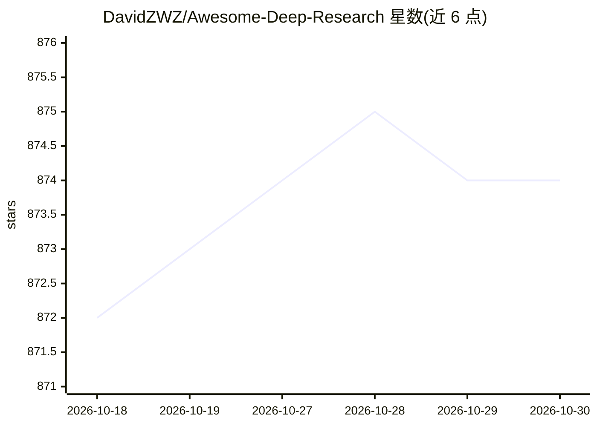

# DavidZWZ/Awesome-Deep-Research

⭐ 874 · MIT · 推送 2026-07-23 · [GitHub](https://github.com/DavidZWZ/Awesome-Deep-Research) · [官网](https://arxiv.org/abs/2506.18959) · 个人维护 · 中文 README

**Agentic Deep Research 领域的资源策展清单（论文/产品/开源实现）**

由研究者维护的 Awesome 类资源清单，围绕 Agentic Deep Research（带推理的深度研究智能体）组织三类内容：业界产品（Gemini/OpenAI/Perplexity/Anthropic 等的 Deep Research 产品）、开源实现（gpt-researcher、DeerFlow 等 20+ 项目）、以及按时间排序的研究论文表格（含基座模型、优化方法、搜索引擎、智能体架构、训练/评测数据集等字段）。另链接维护者的立场论文 From Web Search towards Agentic Deep Research 及姊妹清单 Awesome-RAG-Reasoning。清单本身无安装运行流程，面向查找文献与工具的研究者和开发者。

## 筛选速览

| 维度 | 判定 | 备注 |
|---|---|---|
| AI 角色 | `ai-knowledge` | 知识聚合/清单类 |
| 许可风险 | `permissive` | MIT |
| 部署形态 | `None` |  |
| 模型依赖 | — | README 未给出锁定关系 |
| 硬件要求 | — | 无带数字的原话,不猜 |
| 安装摩擦 | `low` | 无编译、无系统依赖或容器化 |
| 成熟度 | — | 结构信号不足 |

## 能力要点

- 收录业界 Deep Research 产品与 20+ 开源实现
- 论文表格结构化记录基座模型/训练方法/评测数据集等字段
- 链接立场论文与姊妹清单 Awesome-RAG-Reasoning

## 适用场景

- 查找深度研究智能体的最新论文与基线方法
- 对比各产品的开源实现方案
- 调研该领域常用的训练与评测数据集

## 场景标签

`精选清单` `科研工具` · 领域:学习与行业

## 证据(README 行号)

> L17: ## Table of Contents
> L33: ## Open-Source Implementations
> L56: ## Latest Research Papers

## 星数曲线

2026-10-18 872 → 2026-10-30 874（+2）

---
*卡片 v1 · prompt 1.4 · 生成 2026-10-21 · 置信度 high · 依据 README sha `7a7418eb59ce` · [字段定义](../../DATASET.md)*
