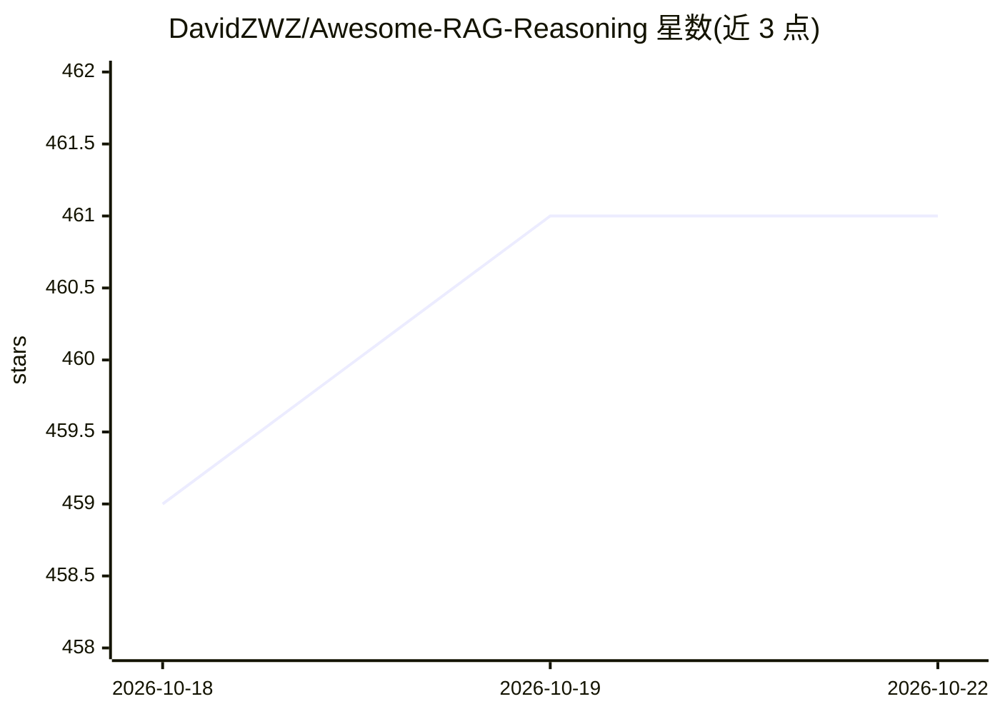

# DavidZWZ/Awesome-RAG-Reasoning

⭐ 461 · MIT · 推送 2026-07-23 · [GitHub](https://github.com/DavidZWZ/Awesome-RAG-Reasoning) · [官网](https://arxiv.org/abs/2507.09477) · 组织维护

**RAG 与推理交叉领域的论文与资源策展清单**

基于 EMNLP 2025 综述论文《Towards Agentic RAG with Deep Reasoning》的分类体系，收录 RAG 与 Reasoning 交叉领域的论文、开源实现与基准数据集，按 Reasoning-Enhanced RAG（检索优化、集成增强等）、RAG-Enhanced Reasoning 与 Synergized RAG-Reasoning System 等类别组织，条目标注会议来源并附论文与代码链接。面向研究者与从业者，用于追踪该交叉方向的方法与实现。仓库为清单形式，不提供可运行代码，需安装的仅为所收录条目各自的代码库。

## 筛选速览

| 维度 | 判定 | 备注 |
|---|---|---|
| AI 角色 | `ai-knowledge` | 知识聚合/清单类 |
| 许可风险 | `permissive` | MIT |
| 部署形态 | `None` |  |
| 模型依赖 | — | README 未给出锁定关系 |
| 硬件要求 | — | 无带数字的原话,不猜 |
| 安装摩擦 | `low` | 无编译、无系统依赖或容器化 |
| 成熟度 | — | 结构信号不足 |

## 能力要点

- 基于 EMNLP 2025 综述论文的分类体系组织条目
- 收录论文、开源实现与基准数据集三类资源
- 条目标注发表会议并附 Paper/Code 链接
- 区分单向增强与迭代协同的 RAG-Reasoning 系统

## 适用场景

- 查找 RAG 与推理结合方向的最新论文和代码
- 了解 RAG-Reasoning 系统的分类与研究框架
- 按任务领域与推理能力挑选基准数据集

## 场景标签

`精选清单` · 领域:学习与行业

## 证据(README 行号)

> L12: A curated collection of resources, papers, tools, and implementations that bridge the gap between **Retrieval-Augme
> L57: Below you will find a curated selection of research papers, open-source implementations, and benchmarking datasets 

## 星数曲线

2026-10-18 459 → 2026-10-22 461（+2）

---
*卡片 v1 · prompt 1.4 · 生成 2026-10-21 · 置信度 high · 依据 README sha `c5fe4b13c622` · [字段定义](../../DATASET.md)*
