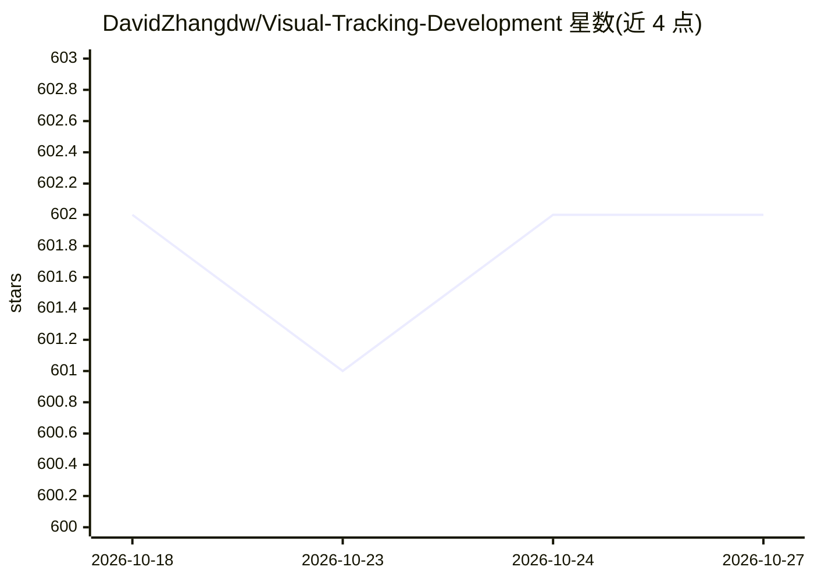

# DavidZhangdw/Visual-Tracking-Development

⭐ 602 · Python · 推送 2026-06-15 · [GitHub](https://github.com/DavidZhangdw/Visual-Tracking-Development) · 组织维护 · 中文 README

**视觉目标跟踪论文清单：按会议年份收录跟踪方法论文与代码**

由浙江师范大学等机构研究者维护的视觉目标跟踪（SOT/MOT）论文聚合清单，以 CVPR 2026、AAAI 2026 等会议为章节组织，每条收录作者、标题、论文链接与代码链接。推荐区涵盖综述（Transformer 跟踪综述、判别滤波与孪生网络综述）、SAM 系列跟踪方法及视频理解相关工作。条目覆盖 RGB-T/RGBT、事件相机、无人机、点云等多模态跟踪方向。仓库本身不提供可运行代码，仅做论文与代码链接的策展。

## 筛选速览

| 维度 | 判定 | 备注 |
|---|---|---|
| AI 角色 | `ai-knowledge` | 知识聚合/清单类 |
| 许可风险 | `none` | — |
| 部署形态 | `None` |  |
| 模型依赖 | — | README 未给出锁定关系 |
| 硬件要求 | — | 无带数字的原话,不猜 |
| 安装摩擦 | `low` | 无编译、无系统依赖或容器化 |
| 成熟度 | — | 结构信号不足 |

## 能力要点

- 按 CVPR 2026 / AAAI 2026 等会议章节组织条目
- 每条含作者、标题、论文链接与代码链接
- 覆盖 RGB-T、事件相机、无人机、点云等多模态跟踪方向
- 推荐区收录多篇跟踪领域综述

## 适用场景

- 查找视觉目标跟踪最新方法论文与开源代码
- 按会议和模态浏览跟踪方向研究进展
- 为跟踪研究选型收集基线方法与基准工作

## 场景标签

`精选清单` · 领域:学习与行业

## 证据(README 行号)

> L9: ## Papers
> L63: ### CVPR 2026
> L225: ### AAAI 2026

## 星数曲线

2026-10-18 602 → 2026-10-27 602（+0）

---
*卡片 v1 · prompt 1.4 · 生成 2026-10-21 · 置信度 high · 依据 README sha `38d4616d0b42` · [字段定义](../../DATASET.md)*
