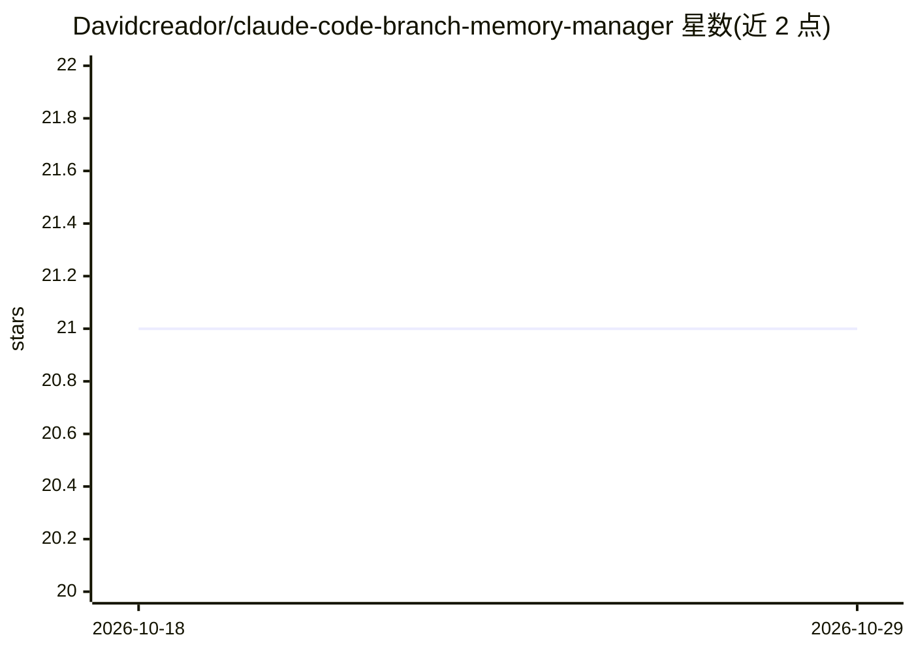

# Davidcreador/claude-code-branch-memory-manager

⭐ 21 · TypeScript · MIT · 推送 2026-06-26 · [GitHub](https://github.com/Davidcreador/claude-code-branch-memory-manager) · 个人维护

**按 git 分支自动切换 CLAUDE.md 上下文的 Claude Code 插件**

面向 Claude Code 用户的分支记忆管理工具：为每个 git 分支保存独立的 CLAUDE.md 文件，存储于仓库内 .claude/memories/。以插件形式安装时通过 SessionStart、PostToolUse、UserPromptSubmit、SessionEnd 四个钩子检测分支切换并自动换入对应记忆，经 additionalContext 机制注入活跃会话；也可作为独立 CLI 使用，提供 save/load/switch/copy/clean 等命令。无记忆分支按 main→master→develop 顺序回退，行为可通过配置文件与环境变量调整。需 Node.js 18+ 与 Git 2.0+。

## 筛选速览

| 维度 | 判定 | 备注 |
|---|---|---|
| AI 角色 | `ai-ecosystem` | LLM/agent 周边工具 |
| 许可风险 | `permissive` | MIT |
| 部署形态 | `library` | 以包/库形式分发 |
| 模型依赖 | locked-api |  |
| 硬件要求 | — | 无带数字的原话,不猜 |
| 安装摩擦 | `low` | 无编译、无系统依赖或容器化 |
| 成熟度 | — | 结构信号不足 |

## 能力要点

- 每个 git 分支对应独立 CLAUDE.md，切换分支自动换入记忆
- 四个 Claude Code 钩子实现自动切换与外部终端分支切换检测
- 可通过 additionalContext 向已加载的活跃会话注入上下文
- 提供独立 CLI（save/load/switch/copy/clean/restore 等命令）

## 适用场景

- 在多个分支间切换开发时保留各自的 Claude Code 上下文与进度笔记
- 团队通过提交 .claude/memories/ 共享分支上下文
- 会话结束时自动保存当前 CLAUDE.md 到对应分支

## 场景标签

`Agent 记忆` · 领域:Agent 开发

## 证据(README 行号)

> L3: Automatic branch-specific `CLAUDE.md` memory management for Claude Code. When you switch git branches, your Claude C
> L13: **As a Claude Code plugin** — memories switch automatically when you run `git checkout` or `git switch` inside Clau

## 星数曲线

2026-10-18 21 → 2026-10-29 21（+0）

---
*卡片 v1 · prompt 1.4 · 生成 2026-10-28 · 置信度 high · 依据 README sha `3c3568b870d2` · [字段定义](../../DATASET.md)*
