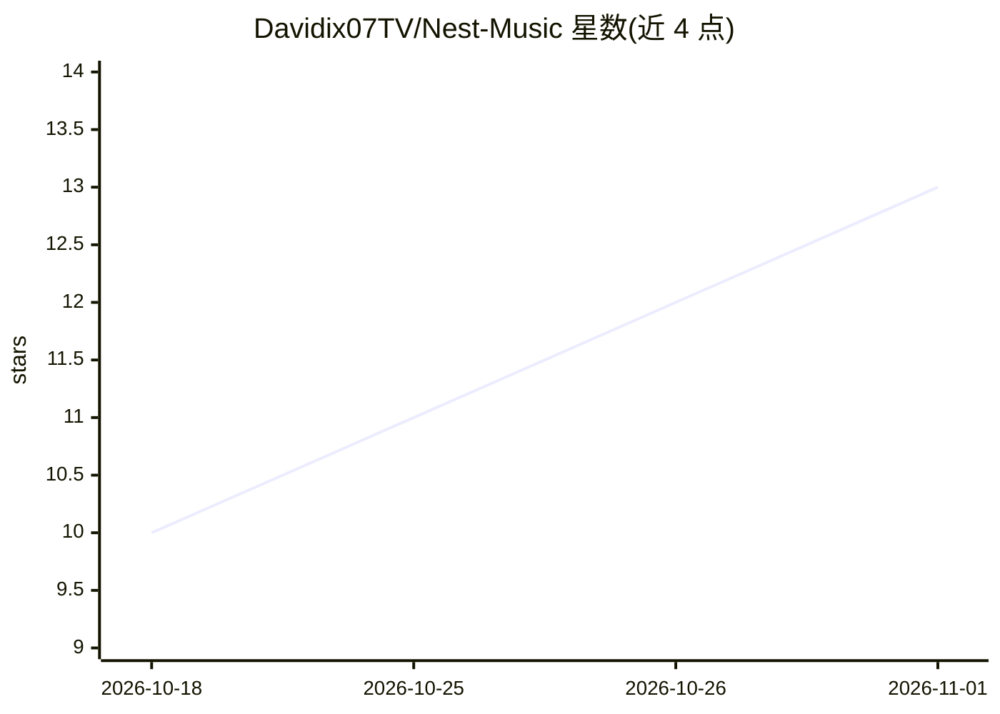

# Davidix07TV/Nest-Music

⭐ 13 · Kotlin · GPL-3.0 · 推送 2026-10-25 · [GitHub](https://github.com/Davidix07TV/Nest-Music) · [官网](https://davidix07tv.github.io/Nest-Music/) · 个人维护

**YouTube Music 第三方客户端，支持 Android/Windows/Linux**

Nest Music 是 Metrolist 与 Kodama 项目的 fork，为终端用户提供 YouTube Music 播放：流媒体播放、后台播放、离线缓存下载、音频均衡与变速、逐字同步歌词、歌单管理与账号同步、实时共听、Discord Rich Presence 等。AI 相关功能包括 AI 歌词翻译与文本提示生成歌单。Android 端提供 FOSS/GMS 两种构建；桌面端基于 Tauri 2（React+Rust+Python sidecar），支持 Linux MPRIS 与系统托盘，需自行构建。受地区限制影响，YouTube Music 不可用地区需 VPN/代理。

## 筛选速览

| 维度 | 判定 | 备注 |
|---|---|---|
| AI 角色 | `ai-enhanced` | 去掉 AI 部分产品仍成立 |
| 许可风险 | `viral` | GPL-3.0 |
| 部署形态 | `None` |  |
| 模型依赖 | — | README 未给出锁定关系 |
| 硬件要求 | — | 无带数字的原话,不猜 |
| 安装摩擦 | `medium` | 含编译或系统依赖之一 |
| 成熟度 | — | 结构信号不足 |

## 能力要点

- 流媒体/后台播放/离线下载与逐字同步歌词
- AI 歌词翻译与文本提示生成歌单
- FOSS 与 GMS 双构建，桌面端 Tauri 2 支持 Windows/Linux
- 实时共听、Discord Rich Presence、Android Auto 支持

## 适用场景

- 在 Android/桌面端收听并管理 YouTube Music 曲库
- 离线缓存歌曲与查看同步歌词
- 与朋友实时共听并分享播放状态

## 场景标签

 · 领域:音乐/媒体播放

## 证据(README 行号)

> L5: ### YouTube Music client for Android, Windows and Linux!
> L40: - AI-powered lyrics translation
> L41: - AI playlist generation from a text prompt

## 星数曲线

2026-10-18 10 → 2026-11-01 13（+3）

---
*卡片 v1 · prompt 1.4 · 生成 2026-10-31 · 置信度 high · 依据 README sha `b7b60ad5d901` · [字段定义](../../DATASET.md)*
