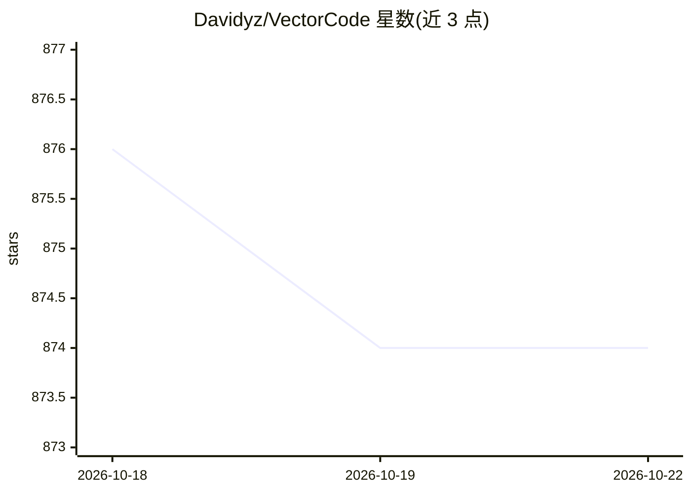

# Davidyz/VectorCode

⭐ 874 · Python · MIT · 推送 2026-02-23 · [GitHub](https://github.com/Davidyz/VectorCode) · 个人维护

**为编程 LLM 提供代码仓库索引与上下文注入的工具，含 Neovim 插件**

VectorCode 对本地代码仓库做索引（支持分块、语义/语法级 smart chunking），将任务相关的代码片段注入编程 LLM 的提示词中，用于补充闭源/小众项目与前沿开发中模型的上下文缺口。以 CLI 工具形式提供，仓库内附 Neovim 插件与 Lua API，供构建或增强 AI 插件，并集成部分流行插件；支持 MCP 与 codecompanion.nvim 联合检索，后端使用 Chromadb（远程版带认证的支持仍在 TODO）。项目自述处于 beta 阶段、快速迭代，采用 0.x 版本号约定：minor 表示破坏性变更，patch 表示非破坏性变更。

## 筛选速览

| 维度 | 判定 | 备注 |
|---|---|---|
| AI 角色 | `ai-ecosystem` | LLM/agent 周边工具 |
| 许可风险 | `permissive` | MIT |
| 部署形态 | `library` | 以包/库形式分发 |
| 模型依赖 | — | README 未给出锁定关系 |
| 硬件要求 | — | 无带数字的原话,不猜 |
| 安装摩擦 | `low` | 无编译、无系统依赖或容器化 |
| 成熟度 | `idea` | |

## 能力要点

- 代码仓库索引与分块（py-tree-sitter 语义/语法分块，chunk-size 可配置）
- 提供 Neovim 插件与 Lua API，可构建或增强 AI 插件
- MCP 接口与 codecompanion.nvim 联合检索支持
- 尊重 .gitignore，支持 .vectorcode/.git 作为项目根锚点

## 适用场景

- 为编程 LLM 补充私有/小众代码库的上下文以改进输出
- 在 Neovim 中为 AI 编程插件接入仓库检索能力
- 通过 MCP 让 agent 客户端检索项目代码片段

## 场景标签

`RAG` · 领域:知识与检索

## 证据(README 行号)

> L7: VectorCode is a code repository indexing tool. It helps you build better prompt
> L23: VectorCode, you can easily (and programmatically) inject task-relevant context

## 星数曲线

2026-10-18 876 → 2026-10-22 874（-2）

---
*卡片 v1 · prompt 1.4 · 生成 2026-10-21 · 置信度 high · 依据 README sha `8ab976beff8c` · [字段定义](../../DATASET.md)*
