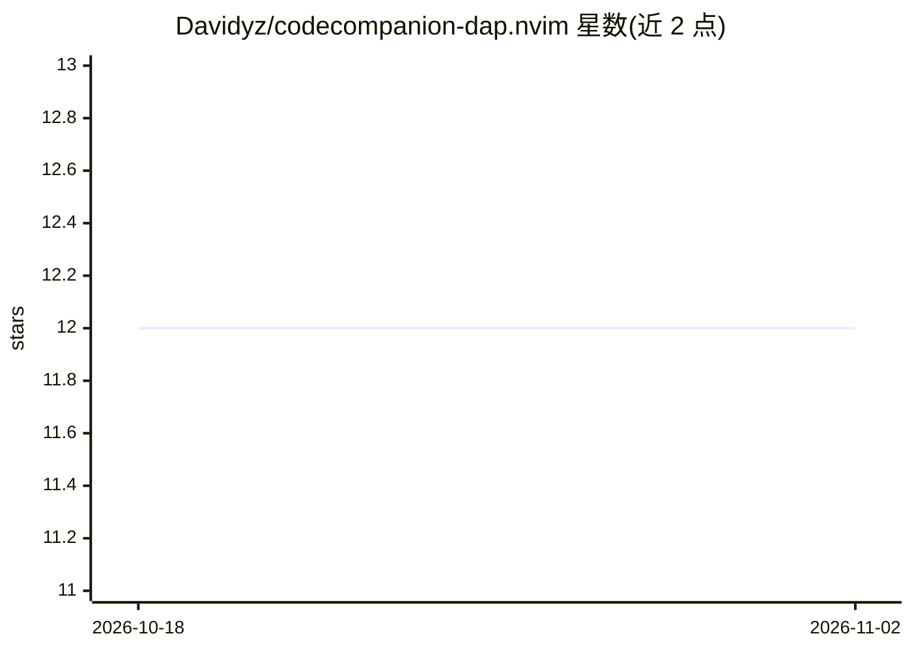

# Davidyz/codecompanion-dap.nvim

⭐ 12 · Lua · MIT · 推送 2025-12-28 · [GitHub](https://github.com/Davidyz/codecompanion-dap.nvim) · 个人维护

**让 codecompanion.nvim 中的 LLM 操作 nvim-dap 调试会话的 Neovim 扩展**

codecompanion.nvim 的扩展插件，在 nvim-dap 调试会话与 LLM 聊天缓冲区之间建立桥梁：通过 `@{dap}` 工具组向 LLM 提供 breakpoints、evaluate、scopes、source、stackTrace、stepping、threads、variables 等 9 类 DAP 请求工具，使 LLM 能探索并操作正在运行的调试会话。提供 interval_ms 选项限制 DAP 请求频率以缓解 LLM 提供商的 TPM/RPM 限制，工具可配置执行前需用户批准。作者自述为实验性项目，个人仅在 Python 调试器（debugpy、coredumpy）上使用。

## 筛选速览

| 维度 | 判定 | 备注 |
|---|---|---|
| AI 角色 | `ai-ecosystem` | LLM/agent 周边工具 |
| 许可风险 | `permissive` | MIT |
| 部署形态 | `None` |  |
| 模型依赖 | — | README 未给出锁定关系 |
| 硬件要求 | — | 无带数字的原话,不猜 |
| 安装摩擦 | `low` | 无编译、无系统依赖或容器化 |
| 成熟度 | `idea` | |

## 能力要点

- 实现 breakpoints/evaluate/stackTrace/stepping 等 9 类 DAP 请求工具
- `@{dap}` 工具组在 codecompanion 聊天缓冲区中供 LLM 调用
- interval_ms 选项限制 DAP 请求最小间隔以缓解提供商速率限制
- 工具支持 require_approval_before 执行前用户批准配置

## 适用场景

- 在 Neovim 中让 LLM 代为查看和操作 DAP 调试会话
- 调试时让 AI 检查变量、调用栈与断点状态
- 配合 codecompanion.nvim 做交互式 AI 辅助调试

## 场景标签

`编码 Agent` · 领域:编码与开发

## 证据(README 行号)

> L1: > A neovim plugin (and codecompanion extension) that bridges
> L4: This codecompanion extension provides tools for the LLM to explore a currently

## 星数曲线

2026-10-18 12 → 2026-11-02 12（+0）

---
*卡片 v1 · prompt 1.4 · 生成 2026-11-01 · 置信度 high · 依据 README sha `946d74e4261e` · [字段定义](../../DATASET.md)*
