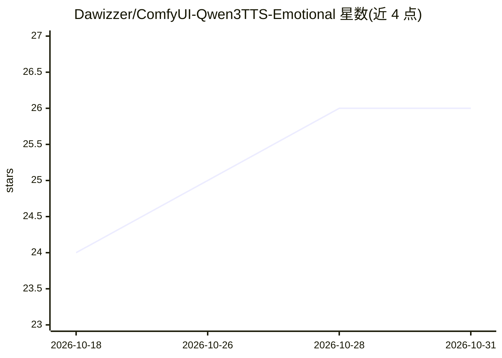

# Dawizzer/ComfyUI-Qwen3TTS-Emotional

⭐ 26 · Python · GPL-3.0 · 推送 2026-01-25 · [GitHub](https://github.com/Dawizzer/ComfyUI-Qwen3TTS-Emotional) · 个人维护

**给 ComfyUI 用户的 Qwen3-TTS 情感语音克隆节点**

ComfyUI 自定义节点，基于 Qwen3-TTS 做声音克隆并叠加情绪控制：提供 80+ 情感预设（核心情绪、强度分级、社交态度、体能状态等类别），支持主/次/三级三层情感混合与 0.0x-2.0x 强度倍率；通过调整 temperature、repetition penalty、top-p 三个生成参数实现。克隆有 Fast（仅说话人向量，3-5 秒）与 Accurate（带参考转写，15-20 秒）两种模式。需先安装 flybirdxx 的 ComfyUI-Qwen-TTS 基础包，再手动放入节点文件并修改 __init__.py；ComfyUI Manager 安装方式标注 Coming Soon。

## 筛选速览

| 维度 | 判定 | 备注 |
|---|---|---|
| AI 角色 | `ai-native` | 本体是模型或模型工具 |
| 许可风险 | `viral` | GPL-3.0 |
| 部署形态 | `library` | 以包/库形式分发 |
| 模型依赖 | — | README 未给出锁定关系 |
| 硬件要求 | — | 无带数字的原话,不猜 |
| 安装摩擦 | `medium` | 含编译或系统依赖之一 |
| 成熟度 | — | 结构信号不足 |

## 能力要点

- 80+ 情感预设（含强度分级、社交态度、体能状态、角色预设等类别）
- 主/次/三级情感三层混合，强度 0.0x-2.0x 倍率可调
- Fast（3-5 秒）与 Accurate（15-20 秒带转写）两种克隆模式
- 通过 temperature / repetition penalty / top-p 参数映射情感

## 适用场景

- 在 ComfyUI 里克隆自己的声音并按剧本情绪配音
- 为角色配音混合多层情感（如紧张+气喘+崩溃）
- 快速迭代试听情感参数组合后再做高质量生成

## 场景标签

`语音合成` · 领域:内容生成

## 证据(README 行号)

> L3: Advanced voice cloning with **80+ emotion presets** and **multi-emotion mixing** for ComfyUI.
> L184: ### How It Works
> L190: Emotions are mixed by averaging their parameter adjustments, then multiplied by intensity.

## 星数曲线

2026-10-18 24 → 2026-10-31 26（+2）

---
*卡片 v1 · prompt 1.4 · 生成 2026-10-27 · 置信度 mid · 依据 README sha `c6f9fb19449b` · [字段定义](../../DATASET.md)*
