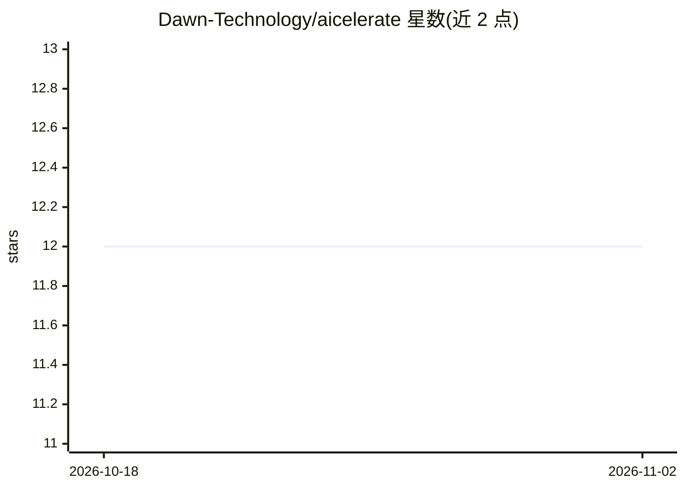

# Dawn-Technology/aicelerate

⭐ 12 · Python · 推送 2026-10-29 · [GitHub](https://github.com/Dawn-Technology/aicelerate) · 组织维护

**Dawn Technology 的 agent 插件市场，含 aimate 技能插件**

面向 GitHub Copilot 生态的 agent 插件市场仓库，核心是 aimate 插件，为其“保障交付流程”提供可复用技能：覆盖 write-prd → prepare-ticket → implement-ticket → review-prd 的规格驱动开发工作流，附带 write-commit-message 技能（读取 staged diff、从分支名提取 Jira key、自动提交）与语气规范文件。支持 VS Code 与 Copilot CLI 安装，并通过 symlink 清单兼容 Claude Code（Windows 下需启用 git core.symlinks）。插件不内置编码 agent 与 MCP 连接，需各团队自行配置；并推荐外部技能（grilling、ADR）与 Context7 MCP 服务器搭配使用。

## 筛选速览

| 维度 | 判定 | 备注 |
|---|---|---|
| AI 角色 | `ai-ecosystem` | LLM/agent 周边工具 |
| 许可风险 | `none` | — |
| 部署形态 | `library` | 以包/库形式分发 |
| 模型依赖 | — | README 未给出锁定关系 |
| 硬件要求 | — | 无带数字的原话,不猜 |
| 安装摩擦 | `low` | 无编译、无系统依赖或容器化 |
| 成熟度 | `idea` | |

## 能力要点

- aimate 插件提供规格驱动开发工作流（PRD→工单→实现→评审）
- write-commit-message 技能自动起草并提交符合规范的 commit
- 通过 VS Code 插件市场、Copilot CLI 与 Claude Code 三种途径安装
- configure-mcp 向导校验 gh/glab/acli 认证并保存路由策略

## 适用场景

- 在 Copilot 或 Claude Code 中按规格驱动流程开发功能
- 让 agent 自动生成统一规范的 commit message
- 团队在共享技能基础上叠加项目专属 agent 与技能

## 场景标签

`工作流自动化` `编码 Agent` · 领域:效率与自动化

## 证据(README 行号)

> L3: An agent plugin marketplace by Dawn Technology, containing the `aimate` plugin with reusable skills for support in o
> L58: ### Claude Code Compatibility
> L226: The main workflow is **`write-prd` → `prepare-ticket` → `implement-ticket` → `review-pr`**. Use `write-prd` to kic

## 星数曲线

2026-10-18 12 → 2026-11-02 12（+0）

---
*卡片 v1 · prompt 1.4 · 生成 2026-11-01 · 置信度 mid · 依据 README sha `12178da18964` · [字段定义](../../DATASET.md)*
