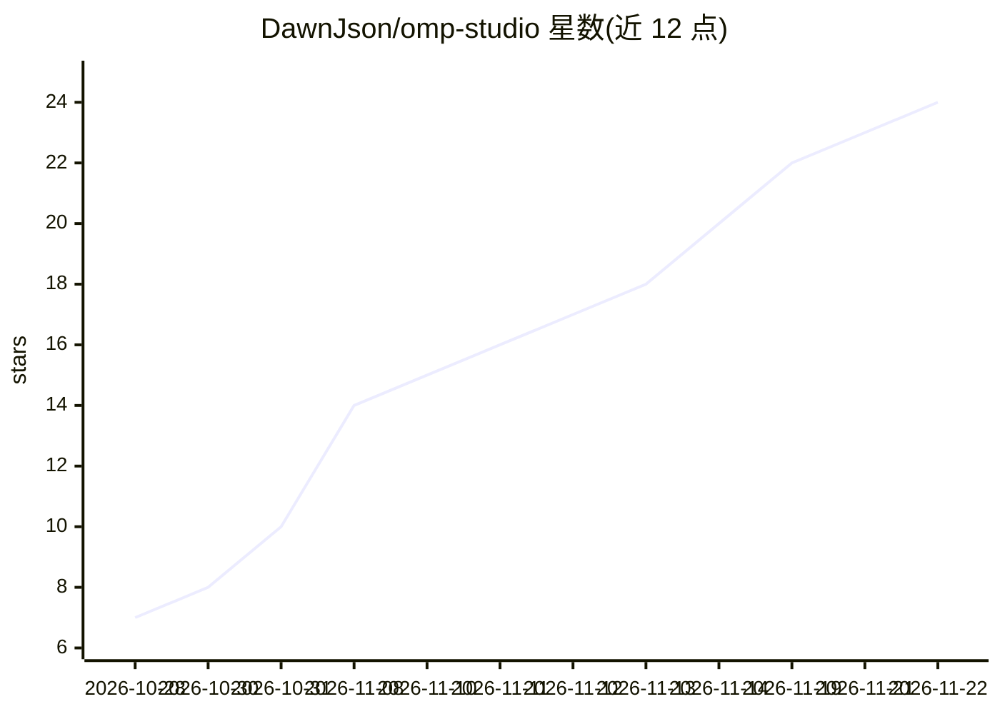

# DawnJson/omp-studio

⭐ 24 · TypeScript · MIT · 推送 2026-11-21 · [GitHub](https://github.com/DawnJson/omp-studio) · 个人维护 · 中文 README

**为 oh-my-pi 编码代理提供 Windows/macOS/Linux 桌面界面**

基于 Electron 的桌面应用，通过伪终端运行官方未修改的 omp 编码代理，经 TSP 协议渲染界面，子代理、todo 板、审批等行为与终端版一致。与终端版共享 ~/.omp 中的登录、设置与会话；提供按项目分组的任务列表、逐行暂存/生成提交信息的审查面板、分支菜单、worktree、内置终端与托盘模式。可代为下载并管理 omp 官方构建，支持增量自动更新。提供 Windows 安装包、macOS arm64 dmg/zip 与 Linux AppImage；Intel Mac 暂不支持。

## 筛选速览

| 维度 | 判定 | 备注 |
|---|---|---|
| AI 角色 | `ai-ecosystem` | LLM/agent 周边工具 |
| 许可风险 | `permissive` | MIT |
| 部署形态 | `desktop` | 安装包/桌面程序 |
| 模型依赖 | — | README 未给出锁定关系 |
| 硬件要求 | — | 无带数字的原话,不猜 |
| 安装摩擦 | `low` | 无编译、无系统依赖或容器化 |
| 成熟度 | — | 结构信号不足 |

## 能力要点

- 通过伪终端运行官方未修改的 omp，经 TSP 协议渲染 UI
- 与终端版共享登录、设置与会话（~/.omp）
- 审查面板支持逐文件/逐行暂存，omp 生成提交信息
- 管理 omp 官方构建的下载、sha256 校验与增量自动更新

## 适用场景

- 在桌面图形界面中运行并继续终端里开始的 omp 会话
- 以逐行暂存与生成提交信息的方式审查代理改动
- 在 Windows 上无需 WSL 使用 omp 编码代理

## 场景标签

`编码 Agent` · 领域:编码与开发

## 证据(README 行号)

> L3:  A desktop app for oh-my-pi (omp). It runs the official, unmodified omp and shares logins, settings and sessions wit
> L20: - **It is the real omp.** Each task runs interactive omp in a pseudo-terminal, and the window draws what omp sends 
> L60: - Each task runs interactive omp in a pseudo-terminal. The UI renders the nodes omp sends over the TSP protocol, an

## 星数曲线

2026-10-28 7 → 2026-11-22 24（+17）

---
*卡片 v1 · prompt 1.4 · 生成 2026-11-18 · 置信度 high · 依据 README sha `59dedfdcc7c1` · [字段定义](../../DATASET.md)*
