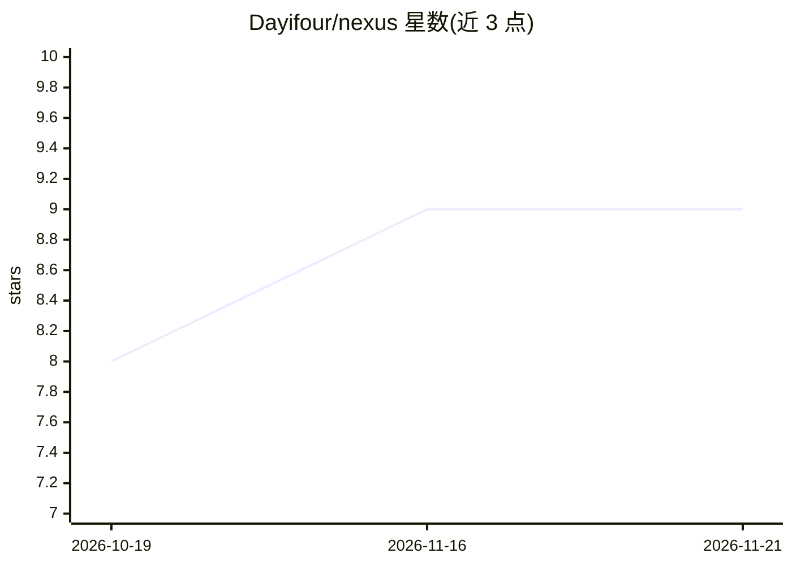

# Dayifour/nexus

⭐ 9 · TypeScript · Apache-2.0 · 推送 2026-10-19 · [GitHub](https://github.com/Dayifour/nexus) · 个人维护

**在桌面 IDE 中编排多个 AI 编码 CLI 协作完成任务的工具**

Nexus 是一个本地桌面 IDE（Electron），用于运行 Claude Code、Codex、OpenCode、Hermes 等 agent CLI：可单独运行，也可组成团队——指挥 agent（conductor）将目标拆成依赖图，各 agent 在隔离的 Git worktree 中并行编码，通过 MCP 团队总线互相通信，结果经用户审查后合并。Nexus 不替代这些 CLI，只负责启动、隔离、编排、消息转发、审查与合并。Linux 为已验证平台，Windows/macOS 构建为实验性；源码构建需 Node 24.18 与 pnpm 11。

## 筛选速览

| 维度 | 判定 | 备注 |
|---|---|---|
| AI 角色 | `ai-ecosystem` | LLM/agent 周边工具 |
| 许可风险 | `permissive` | Apache-2.0 |
| 部署形态 | `desktop` | 安装包/桌面程序 |
| 模型依赖 | — | README 未给出锁定关系 |
| 硬件要求 | — | 无带数字的原话,不猜 |
| 安装摩擦 | `low` | 无编译、无系统依赖或容器化 |
| 成熟度 | `idea` | |

## 能力要点

- Orchestra 模式：conductor 规划任务依赖图，agent 并行工作并通过 nexus MCP 团队总线通信
- 三种会话模式：Supervised（隔离 worktree + diff 审查）、Autonomous、Sandboxed（bubblewrap + seccomp）
- Broadcast：同一指令发给多个 agent 并比较结果
- IDE 工作区：文件浏览、Monaco 编辑器、PTY 终端、Git 与 gh PR 操作

## 适用场景

- 让多个编码 agent 在同一目标下并行开发并在隔离副本中验证
- 对比不同 agent CLI 对同一指令的产出
- 以沙箱方式在 Linux 上运行不受信任的编码任务

## 场景标签

`多智能体` `编码 Agent` · 领域:Agent 开发

## 证据(README 行号)

> L29: **The agent CLIs do the coding — Nexus never replaces them.** Claude Code, Codex, Gemini CLI, Qwen Code, OpenCode a
> L31: launches them, **isolates** them (worktree copy, optional sandbox), **orchestrates** them (plan, task graph, hand-o
> L85: - **Orchestra** — a conductor agent (read-only) plans the goal as a dependency graph; tasks run in parallel in a sh

## 星数曲线

2026-10-19 8 → 2026-11-21 9（+1）

---
*卡片 v1 · prompt 1.4 · 生成 2026-11-20 · 置信度 mid · 依据 README sha `bdf0858b47af` · [字段定义](../../DATASET.md)*
