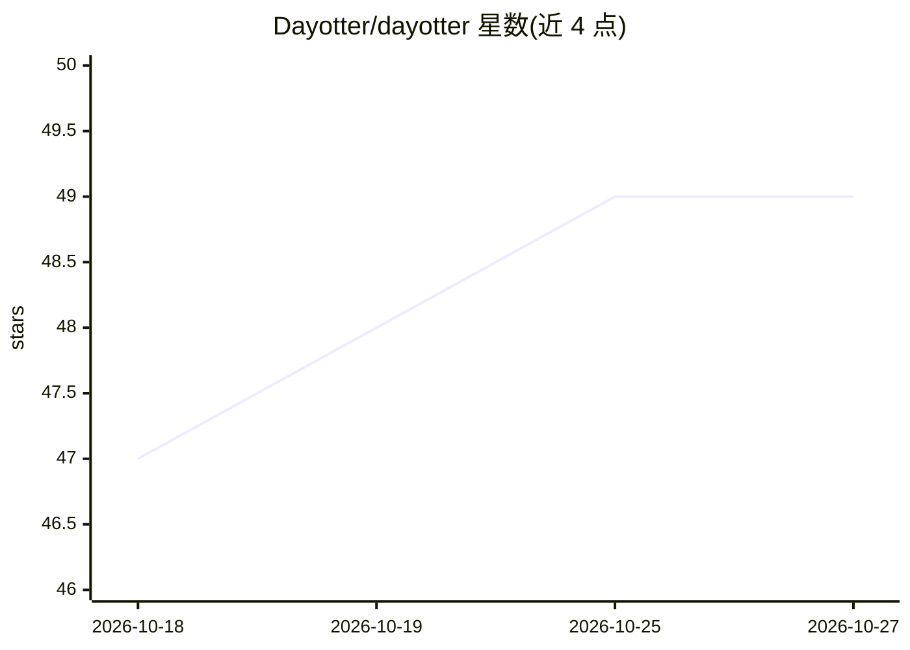

# Dayotter/dayotter

⭐ 49 · TypeScript · AGPL-3.0 · 推送 2026-10-26 · [GitHub](https://github.com/Dayotter/dayotter) · [官网](https://dayotter.com) · 组织维护

**开源自托管日历与预约平台，内置 AI 助手 Otter**

TypeScript/Next.js 编写的日历聚合与预约排程应用：连接 Google、Microsoft 365、Apple CalDAV 及任意 ICS 源作为单一日历处理，提供预约页、加权轮转团队排程、Stripe 支付、多渠道提醒与 Expo 移动端（Android 已上架）。内置 AI 助手 Otter：自然语言/语音/WhatsApp 命令、专注时间保护、迟到提醒、会议纪要，采用 confirm-first 机制（需确认才改动日历）。AI 为可选项，模型支持 Anthropic/OpenAI 或本地 Ollama/LM Studio/vLLM；无 AI 时也可作为完整排程器运行。核心 AGPLv3，ee/ 目录为独立授权的云端商业层；项目自述处于早期阶段。

## 筛选速览

| 维度 | 判定 | 备注 |
|---|---|---|
| AI 角色 | `ai-enhanced` | 去掉 AI 部分产品仍成立 |
| 许可风险 | `dual` | AGPL-3.0 |
| 部署形态 | `self-host` | docker 或自建部署 |
| 模型依赖 | local-ok | 支持本地模型 |
| 硬件要求 | — | 无带数字的原话,不猜 |
| 安装摩擦 | `low` | 无编译、无系统依赖或容器化 |
| 成熟度 | `idea` | |

## 能力要点

- 多日历聚合为单一可用性视图，跨账号防重复预订
- AI 助手 Otter 可接 Anthropic/OpenAI 或本地 Ollama/LM Studio/vLLM
- confirm-first 机制：AI 不经确认不修改日历
- 一条命令自托管（Docker Compose 含 Postgres/Redis/web/worker），Android 应用已上架 Google Play

## 适用场景

- 我需要把个人与工作多个日历合成一个预约链接
- 团队要做轮转排程和集体可用时间管理
- 组织要在自有服务器上运行完整排程产品并保留数据

## 场景标签

`AI 助手` · 领域:对话与助手

## 证据(README 行号)

> L33: > **The AI is optional and never a black box.** DayOtter runs as a complete scheduler with **no AI configured at al
> L120: Run the whole product - **web, worker, Postgres, Redis** - on your own infrastructure under AGPLv3. AI is **option

## 星数曲线

2026-10-18 47 → 2026-10-27 49（+2）

---
*卡片 v1 · prompt 1.4 · 生成 2026-10-25 · 置信度 high · 依据 README sha `8a12060996af` · [字段定义](../../DATASET.md)*
