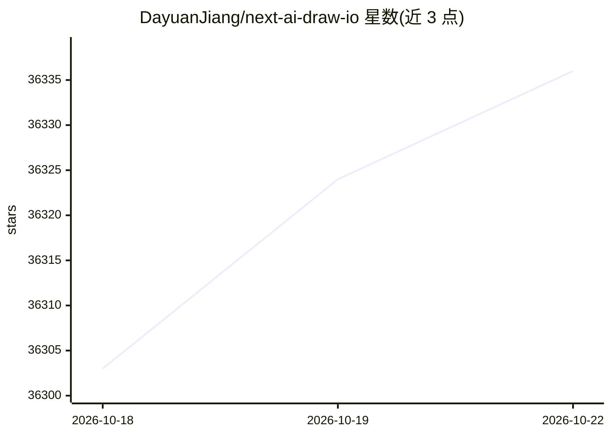

# DayuanJiang/next-ai-draw-io

⭐ 36,373 · TypeScript · Apache-2.0 · 推送 2026-10-22 · [GitHub](https://github.com/DayuanJiang/next-ai-draw-io) · [官网](https://next-ai-drawio.jiang.jp/) · 个人维护

**通过对话生成与编辑 draw.io 图表的 AI 工具**

以自然语言描述生成 draw.io 图表的工具，支持手动编辑、选中局部让 AI 修改、每次 AI 变更生成可对比/恢复/撤销的版本卡片，导出 .drawio/.png/.svg。内置 AWS/Azure/GCP/Kubernetes 图标库，可上传截图、草图、PDF、Markdown 等由 AI 重绘为图表。提供 Web 应用、Windows/macOS/Linux 桌面应用及面向 Claude Code、Cursor、VS Code 等 agent 的 MCP 服务器；支持 25 家模型服务商，API key 存于本地浏览器。自托管需配置服务商与 API key。

## 筛选速览

| 维度 | 判定 | 备注 |
|---|---|---|
| AI 角色 | `ai-native` | 本体是模型或模型工具 |
| 许可风险 | `permissive` | Apache-2.0 |
| 部署形态 | `desktop` | 安装包/桌面程序 |
| 模型依赖 | local-ok | 支持本地模型 |
| 硬件要求 | — | 无带数字的原话,不猜 |
| 安装摩擦 | `low` | 无编译、无系统依赖或容器化 |
| 成熟度 | — | 结构信号不足 |

## 动量与使用信号

- 维护:`active` — 距上次 push 0.7 天,年发版 19,69 位贡献者
- 涨星:近 1 天 **+31**(自 20261016 起算)
- 下载:GitHub Release 附件 累计 152,101(19 个 release)
- 平台:WINDOWS / MACOS / LINUX / WEB · 协议:OPENAI-API / MCP / OLLAMA

## 能力要点

- 对话生成与局部选中编辑，每次 AI 变更为可对比/恢复的版本卡片
- MCP 服务器形式接入 Claude Code、Cursor、VS Code 等客户端
- 内置 AWS、Azure、GCP、Kubernetes 图标库与连接线流动动画
- 支持 25 家模型服务商及 OpenAI 兼容自定义 URL，key 保留在本地

## 适用场景

- 一句话生成云架构图、流程图、时序图
- 把截图、草图或代码文件重绘为图表
- 在 Cursor/VS Code 等 agent 中直接绘制图表
- 自托管部署给团队内部使用

## 场景标签

 · 领域:开发者工具/图表生成

## 证据(README 行号)

> L3: **Draw and edit draw.io diagrams by chatting with an AI.**
> L18: Available as a web app, a desktop app for Windows, macOS and Linux, and an MCP server for AI agents such as Claude 
> L150: 25 providers are supported: AWS Bedrock (default), OpenAI, Anthropic, Google AI, Google Vertex AI, Azure OpenAI, O

## 星数曲线

2026-10-18 36,303 → 2026-10-22 36,336（+33）

---
*卡片 v1 · prompt 1.4 · 生成 2026-10-18 · 置信度 high · 依据 README sha `7428f882f746` · [字段定义](../../DATASET.md)*
