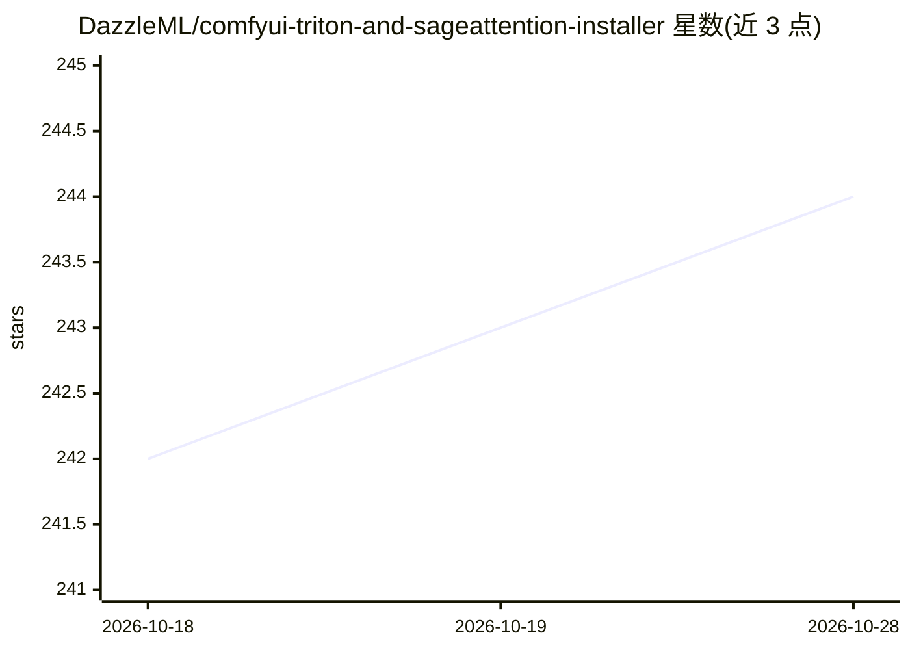

# DazzleML/comfyui-triton-and-sageattention-installer

⭐ 245 · Python · MIT · 推送 2026-08-11 · [GitHub](https://github.com/DazzleML/comfyui-triton-and-sageattention-installer) · 组织维护

**Windows 用户在 ComfyUI 中自动安装 Triton 与 SageAttention 的安装器**

面向 Windows ComfyUI 用户的 Python 脚本安装器：一条命令安装 Triton（triton-windows）与 SageAttention 1/2，自动检测 GPU 与 CUDA 版本、优先使用预编译 wheel、自动安装 Visual Studio Build Tools 与 Python 开发头文件，支持 RTX 5090（CUDA 12.8/Blackwell）。附带 ComfyUI 安装位置发现、dry-run 预览、环境备份/恢复、ComfyUI Portable 嵌入式 Python 支持，另含面向 RTX 5090 的 AI Toolkit（LoRA 训练）安装脚本。Linux/macOS 仅有实验性占位。

## 筛选速览

| 维度 | 判定 | 备注 |
|---|---|---|
| AI 角色 | `ai-ecosystem` | LLM/agent 周边工具 |
| 许可风险 | `permissive` | MIT |
| 部署形态 | `desktop` | 安装包/桌面程序 |
| 模型依赖 | — | README 未给出锁定关系 |
| 硬件要求 | — | 无带数字的原话,不猜 |
| 安装摩擦 | `medium` | 含编译或系统依赖之一 |
| 成熟度 | `idea` | |

## 能力要点

- 一条命令安装 Triton 与 SageAttention，无需手动编译
- 自动检测 GPU/CUDA 版本并匹配预编译 wheel，失败时回退 SageAttention 1.0.6
- 支持 RTX 5090（Blackwell，CUDA 12.8）与 ComfyUI Portable 嵌入式 Python
- 附带 RTX 5090 用户的 AI Toolkit LoRA 训练环境安装脚本

## 适用场景

- 在 Windows 上为 ComfyUI 装上 SageAttention 加速而不用手动编译
- RTX 5090 用户配置 CUDA 12.8 的推理与 LoRA 训练环境
- 安装前备份 ComfyUI 环境，出问题后手动恢复

## 场景标签

 · 领域:AI 工具链/安装器

## 证据(README 行号)

> L10: Cross-platform installer for Triton and SageAttention on ComfyUI. Simplifies GPU-accelerated inference setup for Wi
> L156: 1. **PyTorch** with CUDA support matching your GPU

## 星数曲线

2026-10-18 242 → 2026-10-28 244（+2）

---
*卡片 v1 · prompt 1.4 · 生成 2026-10-22 · 置信度 high · 依据 README sha `f76e68ee4c32` · [字段定义](../../DATASET.md)*
