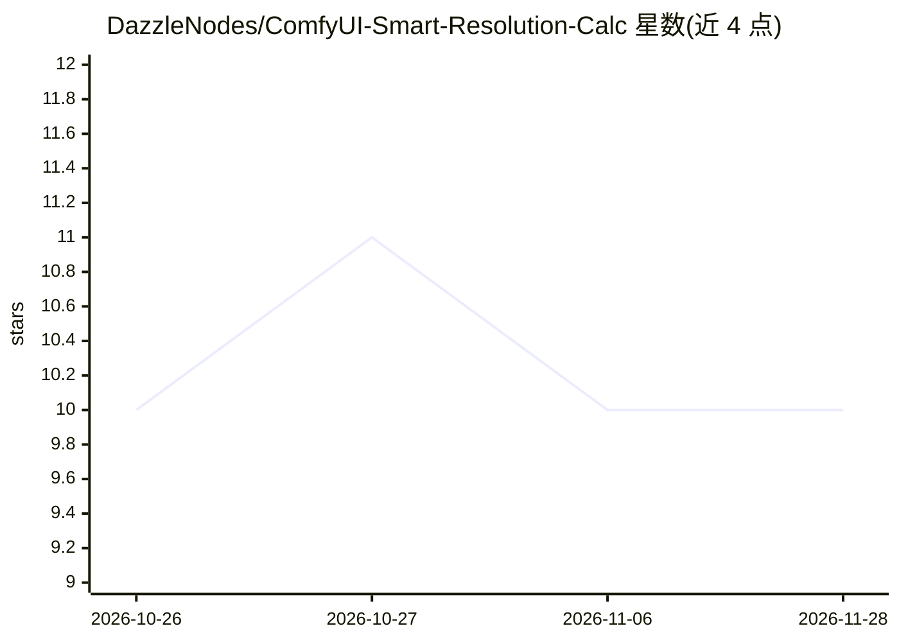

# DazzleNodes/ComfyUI-Smart-Resolution-Calc

⭐ 10 · JavaScript · MIT · 推送 2026-10-23 · [GitHub](https://github.com/DazzleNodes/ComfyUI-Smart-Resolution-Calc) · 个人维护

**ComfyUI 分辨率计算节点：按已知边与比例自动算尺寸并生成 latent**

作为 ComfyUI 自定义节点，替代手工尺寸换算：用户开启已知项（宽/高/兆像素/宽高比或参考图），节点按优先级推算其余数值，并按 8/16/32/64 可除性取整，直接输出 latent 张量供 KSampler 使用。支持 23 种预设与自定义比例、4 种图像变换模式、基于频谱混合的噪声构图引导，兼容包括视频 VAE（Wan/Qwen/HunyuanVideo）在内的多种 VAE。安装依赖 ComfyUI 环境，无额外 Python 依赖。

## 筛选速览

| 维度 | 判定 | 备注 |
|---|---|---|
| AI 角色 | `ai-native` | 本体是模型或模型工具 |
| 许可风险 | `permissive` | MIT |
| 部署形态 | `None` |  |
| 模型依赖 | — | README 未给出锁定关系 |
| 硬件要求 | — | 无带数字的原话,不猜 |
| 安装摩擦 | `low` | 无编译、无系统依赖或容器化 |
| 成熟度 | — | 结构信号不足 |

## 能力要点

- 5 种计算模式（宽+高、宽/高+比例、兆像素+比例、默认），自动推算缺失尺寸
- 直接输出 latent，支持含视频 VAE 在内的多种 VAE 类型
- 频谱混合噪声构图：图案空间结构影响生成画面布局
- 23 种预设宽高比加自定义比例，8/16/32/64 可除性取整

## 适用场景

- 工作流中替代 Empty Latent Image，按目标比例精确出图
- 以参考图提取宽高比或精确尺寸再生成
- 用噪声图案/蒙版控制构图并生成 latent

## 场景标签

`图像生成` · 领域:内容生成

## 证据(README 行号)

> L10: Flexible resolution and latent generation for ComfyUI. Tell the node what you know (width, height, megapixels, aspe
> L46: - **Direct latent output** — supports all VAE types including video VAEs (Wan/Qwen/HunyuanVideo)
> L67: - ComfyUI installation

## 星数曲线

2026-10-26 10 → 2026-11-28 10（+0）

---
*卡片 v1 · prompt 1.4 · 生成 2026-11-20 · 置信度 high · 依据 README sha `d3e7beb32c59` · [字段定义](../../DATASET.md)*
