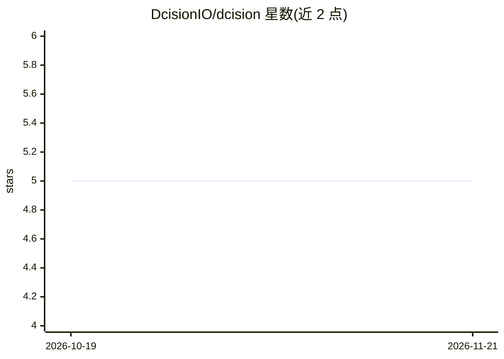

# DcisionIO/dcision

⭐ — · [GitHub]() · 组织维护

**给 agent/LLM 应用提供带置信度的结构化决策 API 层**

Dcision 是一个托管决策服务，定位为 agent 或 LLM 流程前置的决策层：用户以 JSON Schema 声明问题，每次调用返回经 schema 校验的带置信度结果与下一步动作，并按 continue/block/escalate/fallback 策略执行，对低置信度案例可回落到自有 LLM。仓库提供 9 个现成决策模板（线索评分、意图路由、垃圾识别、RAG 相关性等）、cURL/Node.js/Python 调用示例，以及远程 MCP 接入与 Claude Code 技能。服务在 dcision.io 注册使用，免费层每月 100 万次决策，超量按预付额度计费。

## 筛选速览

| 维度 | 判定 | 备注 |
|---|---|---|
| AI 角色 | `ai-ecosystem` | LLM/agent 周边工具 |
| 许可风险 | `permissive` | — |
| 部署形态 | `None` |  |
| 模型依赖 | locked-api |  |
| 硬件要求 | — | 无带数字的原话,不猜 |
| 安装摩擦 | `low` | 无编译、无系统依赖或容器化 |
| 成熟度 | — | 结构信号不足 |

## 能力要点

- 按 JSON Schema 校验的带置信度决策结果与下一动作
- 8 种结果目的地类型：固定回复、结构化 JSON、LLM、agent、workflow、webhook、API 请求、函数
- 远程 MCP 服务器与 Claude Code 技能接入方式
- 9 个现成决策模板与 Playground 免费试运行

## 适用场景

- 在调用 LLM 前过滤工单路由、意图分类等微决策
- 为 RAG 流程预判检索片段是否与查询相关
- 让 Claude Code 等 agent 通过 MCP 调用决策 API

## 场景标签

 · 领域:LLM 基础设施/决策服务

## 证据(README 行号)

> L24: **Dcision is the decision layer that sits before your agent or LLM.** You declare the questions once, in a schema.
> L57: |**MCP**|—|**Remote MCP server** for agents, plus a Claude Code skill|
> L96: |**Any language**|`POST https://api.dcision.io/v1/decisions/{slug}` with your API key (examples)|

## 星数曲线

2026-10-19 5 → 2026-11-21 5（+0）

---
*卡片 v1 · prompt 1.4 · 生成 2026-11-21 · 置信度 high · 依据 README sha `15c69a13018c` · [字段定义](../../DATASET.md)*
