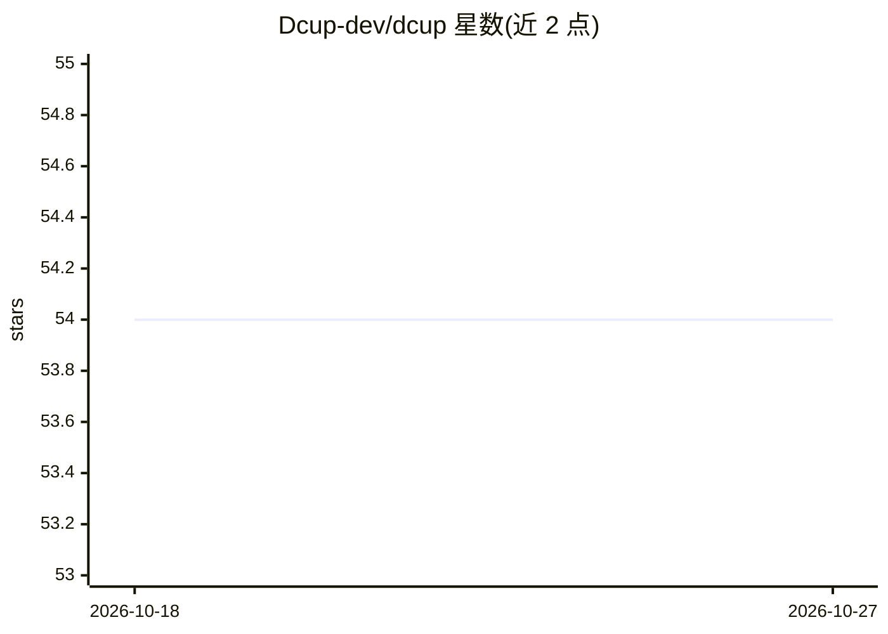

# Dcup-dev/dcup

⭐ 54 · TypeScript · GPL-3.0 · 推送 2026-02-20 · [GitHub](https://github.com/Dcup-dev/dcup) · [官网](https://dcup.dev/) · 组织维护

**自托管的开源 RAG 平台：数据接入、索引与检索服务**

面向开发者和团队的自托管 RAG 平台（RAG-as-a-Service）。流程分三步：通过 API 从 Google Drive、Dropbox、AWS 或直接上传摄取数据；用 OpenAI embeddings 将数据分块并向量化，存入 Qdrant 向量数据库，支持向量/摘要/关键词索引；再通过检索 API 查询，提供 LLM 重排序、实体抽取、灵活过滤与混合搜索（语义+关键词）。自部署通过 docker compose 完成，另有云端托管版本。

## 筛选速览

| 维度 | 判定 | 备注 |
|---|---|---|
| AI 角色 | `ai-ecosystem` | LLM/agent 周边工具 |
| 许可风险 | `viral` | GPL-3.0 |
| 部署形态 | `self-host` | docker 或自建部署 |
| 模型依赖 | — | README 未给出锁定关系 |
| 硬件要求 | — | 无带数字的原话,不猜 |
| 安装摩擦 | `low` | 无编译、无系统依赖或容器化 |
| 成熟度 | — | 结构信号不足 |

## 能力要点

- Google Drive / Dropbox / AWS 等数据源接入与自动同步
- OpenAI embeddings + Qdrant 向量存储的分块索引流程
- 检索 API 支持 LLM 重排序、实体抽取、混合搜索
- docker compose 自托管部署

## 适用场景

- 团队自托管搭建私有数据的 RAG 检索服务
- 将网盘等外部数据源接入向量检索
- 通过检索 API 为 AI 应用提供带重排序的查询

## 场景标签

`RAG` · 领域:知识与检索

## 证据(README 行号)

> L1: # Dcup: The Open-Source RAG-as-a-Service Platform
> L9: - **Advanced Search Capabilities:** LLM re-ranking, summary indexing, hybrid search using OpenAI embeddings and Qdra
> L22: The final step is retrieval. With the Dcup Retrieval API, you can query your data and refine results. Features like

## 星数曲线

2026-10-18 54 → 2026-10-27 54（+0）

---
*卡片 v1 · prompt 1.4 · 生成 2026-10-24 · 置信度 high · 依据 README sha `fe87d9908632` · [字段定义](../../DATASET.md)*
