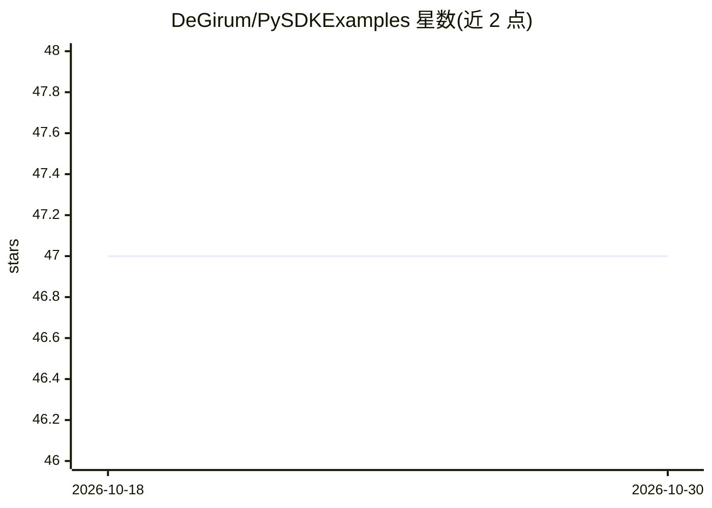

# DeGirum/PySDKExamples

⭐ 47 · Python · MIT · 推送 2026-02-17 · [GitHub](https://github.com/DeGirum/PySDKExamples) · [官网](https://hub.degirum.com) · 组织维护

**DeGirum PySDK 示例集：边缘 AI 推理的用法笔记本合集**

DeGirum 公司维护的 PySDK 官方示例仓库，以 Jupyter 笔记本演示在三种托管选项上执行 ML 推理：DeGirum 云平台、局域网内 DeGirum AI Server、本地 ORCA 加速器，通过 hw_location 变量切换。示例覆盖单模型推理（图像/视频流/音频流）、多模型组合流水线（车牌识别、人脸属性）、多目标跟踪、区域计数、RTSP 智能摄像头等应用，以及性能基准测试。运行需注册 DeGirum Cloud Portal 获取 API token，配置 env.ini；支持 Google Colab 或本地 Jupyter Lab 执行。

## 筛选速览

| 维度 | 判定 | 备注 |
|---|---|---|
| AI 角色 | `ai-ecosystem` | LLM/agent 周边工具 |
| 许可风险 | `permissive` | MIT |
| 部署形态 | `library` | 以包/库形式分发 |
| 模型依赖 | — | README 未给出锁定关系 |
| 硬件要求 | — | 无带数字的原话,不猜 |
| 安装摩擦 | `low` | 无编译、无系统依赖或容器化 |
| 成熟度 | — | 结构信号不足 |

## 能力要点

- 三种推理托管选项：云平台 / AI Server / 本地 ORCA 加速器
- 多模型流水线示例（车牌检测+识别、人脸+年龄性别）
- 多目标跟踪、区域计数、违规事件检测等应用型示例
- 多模型多路视频流基准与性能测试示例

## 适用场景

- 学习用 PySDK API 在云端或本地加速器上跑目标检测
- 参考多模型流水线与视频流推理的工程实现
- 评估 ORCA 加速器上各模型的推理性能

## 场景标签

`目标检测` `教程课程` · 领域:学习与行业

## 证据(README 行号)

> L3: DeGirum PySDK is a software development kit, focused on edge AI development, that supports multiple hardware options
> L30: This repository provides PySDK example scripts that can perform ML inferences on the following hosting options:

## 星数曲线

2026-10-18 47 → 2026-10-30 47（+0）

---
*卡片 v1 · prompt 1.4 · 生成 2026-10-25 · 置信度 high · 依据 README sha `94c456138482` · [字段定义](../../DATASET.md)*
