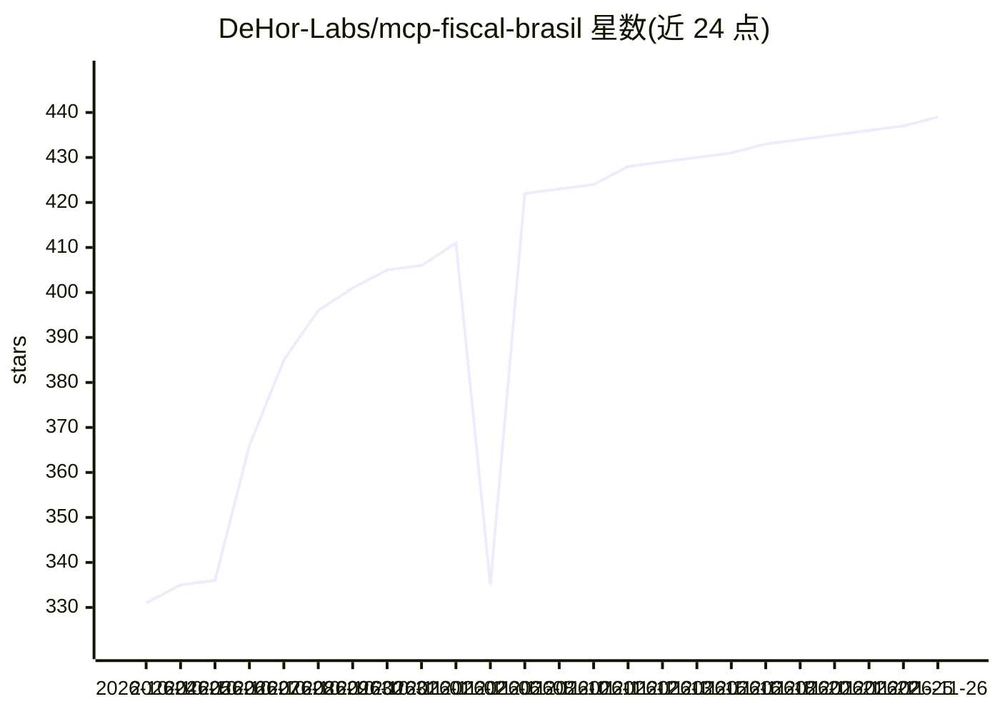

# DeHor-Labs/mcp-fiscal-brasil

⭐ 439 · Python · MIT · 推送 2026-11-15 · [GitHub](https://github.com/DeHor-Labs/mcp-fiscal-brasil) · [官网](https://fiscal.dehor.dev) · 组织维护

**把 AI 助手接入巴西财税数据查询的 MCP 服务器（44 个工具）**

面向巴西财税场景的 MCP 服务器，通过自然语言查询 CNPJ、NF-e、NFS-e、SPED、eSocial、Simples Nacional 与 2026 税改（IBS/CBS）等内容。提供 44 个工具，含 6 个高层 agent 工具（供应商尽调评分、批量筛查、税制对比等）与离线解析/校验工具（XML 解析、XSD 校验、DANFE 生成、离线 NCM/CFOP/CNAE 表）。默认无需注册与 API key；部分 SEFAZ 工具需本地 A1 证书，cpfcnpj.com.br 为可选付费源。除 MCP 外还提供 CLI、REST API 与 Node.js 包装器。

## 筛选速览

| 维度 | 判定 | 备注 |
|---|---|---|
| AI 角色 | `ai-ecosystem` | LLM/agent 周边工具 |
| 许可风险 | `permissive` | MIT |
| 部署形态 | `self-host` | docker 或自建部署 |
| 模型依赖 | locked-api |  |
| 硬件要求 | — | 无带数字的原话,不猜 |
| 安装摩擦 | `low` | 无编译、无系统依赖或容器化 |
| 成熟度 | — | 结构信号不足 |

## 能力要点

- 44 个财税工具，含供应商风险评分、批量 CNPJ 筛查等 6 个 agent 工具
- 零注册零 API key：离线 XML 解析、密钥校验、DANFE PDF 生成与离线参考表
- 支持 Claude Desktop 一键接入，另有 CLI、REST API 与 Node.js 包装器
- SEFAZ mTLS 工具支持本地 A1 证书，证书与密码不出本地

## 适用场景

- 通过 AI 助手用自然语言查询 CNPJ、Simples Nacional 状态
- 对 NF-e XML 做解析、校验签名并生成 DANFE
- 对供应商做批量合规筛查与风险评分
- 把 SPED 文件转成执行摘要与不一致清单

## 场景标签

 · 领域:财税/企业服务/API集成

## 证据(README 行号)

> L64: `mcp-fiscal-brasil` conecta assistentes de IA, ERPs, CRMs e automações internas ao universo fiscal brasileiro: **CN
> L113: **MCP Fiscal Brasil** resolve isso em uma linha: instale o servidor, conecte ao seu assistente de IA, e comece a f
> L95: - **Múltiplas interfaces**: além do servidor MCP, agora CLI (`mcp-fiscal`), REST API (`mcp-fiscal-api`) com Web UI 

## 星数曲线

2026-10-24 331 → 2026-11-26 439（+108）

---
*卡片 v1 · prompt 1.4 · 生成 2026-11-25 · 置信度 mid · 依据 README sha `04060744455a` · [字段定义](../../DATASET.md)*
