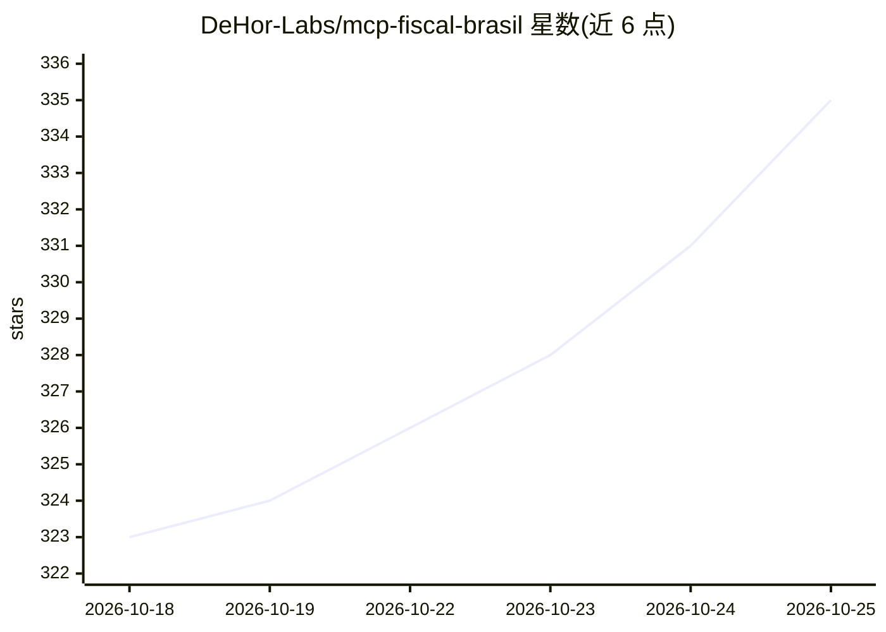

# DeHor-Labs/mcp-fiscal-brasil

⭐ 336 · Python · MIT · 推送 2026-10-23 · [GitHub](https://github.com/DeHor-Labs/mcp-fiscal-brasil) · [官网](https://fiscal.dehor.dev) · 组织维护

**面向巴西财税数据的 MCP 服务器：44 个工具免密查询**

将 AI 助手、ERP、CRM 连接到巴西财税体系的 MCP 服务器：提供 CNPJ/CPF 查询、NF-e 解析与 XMLDSig 签名验证、DANFE PDF 生成、SPED/eSocial 离线分析、Simples Nacional 与 2026 税改（IBS/CBS）支持，共 44 个工具。默认无需注册与 API key，数据来自 BrasilAPI、ReceitaWS 等；SEFAZ 实时操作需本地 A1 证书（opt-in），另有 cpfcnpj.com.br 付费源可选。同时提供 CLI 与 REST API 接口。

## 筛选速览

| 维度 | 判定 | 备注 |
|---|---|---|
| AI 角色 | `ai-ecosystem` | LLM/agent 周边工具 |
| 许可风险 | `permissive` | MIT |
| 部署形态 | `self-host` | docker 或自建部署 |
| 模型依赖 | — | README 未给出锁定关系 |
| 硬件要求 | — | 无带数字的原话,不猜 |
| 安装摩擦 | `low` | 无编译、无系统依赖或容器化 |
| 成熟度 | — | 结构信号不足 |

## 能力要点

- 44 个工具：CNPJ/NF-e/SPED/eSocial/税改 2026 等财税垂直场景
- 默认零注册零 API key，部分工具纯离线（NCM/CFOP/CNAE 内置表）
- 6 个高层 agent 工具如供应商风险评分、税制比较、SPED 摘要
- 除 MCP 服务器外提供 CLI（mcp-fiscal）与 REST API

## 适用场景

- 让 Claude 等 AI 助手用自然语言查询企业财税信息
- 对供应商做风险评分与合规尽调
- 解析和验证 NF-e XML、生成 DANFE PDF
- 分析 SPED/eSocial 文件并比较税制

## 场景标签

`数据分析` · 领域:效率与自动化

## 证据(README 行号)

> L3:  O único servidor MCP com suporte nativo a NF-e, NFS-e, SPED, eSocial, Simples Nacional e Reforma Tributária 2026 (I
> L64: `mcp-fiscal-brasil` conecta assistentes de IA, ERPs, CRMs e automações internas ao universo fiscal brasileiro: **CN
> L66: Ele não tenta ser um catálogo genérico de dados públicos. A proposta é ser uma vertical de produto: transformar con

## 星数曲线

2026-10-18 323 → 2026-10-25 335（+12）

---
*卡片 v1 · prompt 1.4 · 生成 2026-10-21 · 置信度 mid · 依据 README sha `4719b0554d90` · [字段定义](../../DATASET.md)*
