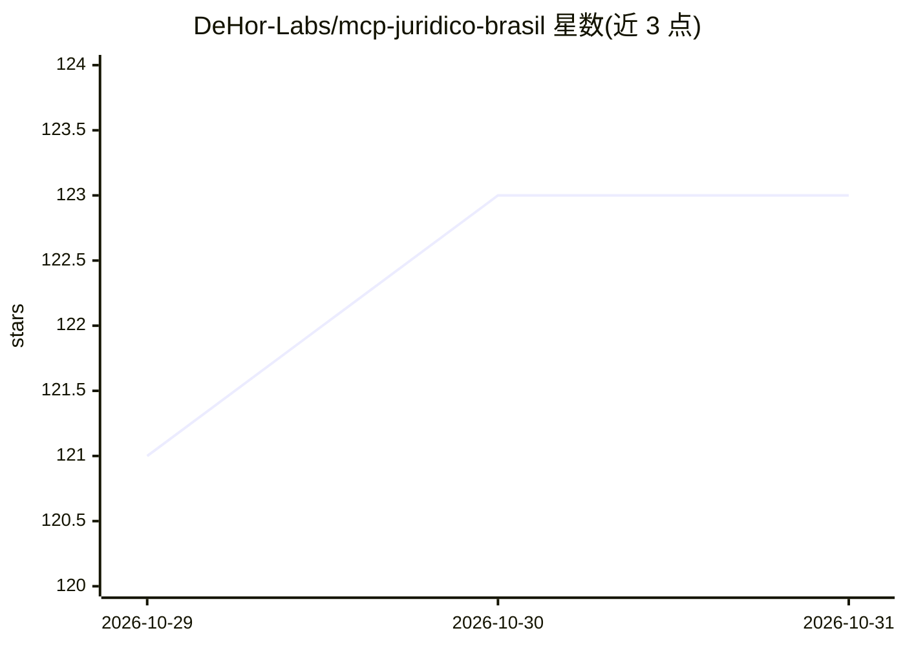

# DeHor-Labs/mcp-juridico-brasil

⭐ 123 · Python · MIT · 推送 2026-10-26 · [GitHub](https://github.com/DeHor-Labs/mcp-juridico-brasil) · [官网](https://juridico.dehor.dev) · 组织维护

**MCP 服务器：让 AI 助手接入巴西 DataJud 司法数据查询**

面向 AI 助手、律所与案件管理系统的 MCP 服务器，将巴西 CNJ 的 DataJud 统一司法数据库封装为 9 个 tool 与 1 个 resource：按 CNJ 案号查案件、列诉讼进展、监测案件更新、按 CPC 第 219/220/224 条以工作日（含法院休假期与节假日）计算期限；登记 92 个法院代号；可选接入 Domicílio Judicial Eletrônico 读取与确认送达（确认具有法律效力，默认 dry-run）。通过 PyPI/uvx/pip 安装，配置到 Claude Desktop、Claude Code、Cursor、VS Code+Continue 等 MCP 客户端。查询类 tool 不落盘存储数据。

## 筛选速览

| 维度 | 判定 | 备注 |
|---|---|---|
| AI 角色 | `ai-ecosystem` | LLM/agent 周边工具 |
| 许可风险 | `permissive` | MIT |
| 部署形态 | `library` | 以包/库形式分发 |
| 模型依赖 | — | README 未给出锁定关系 |
| 硬件要求 | — | 无带数字的原话,不猜 |
| 安装摩擦 | `low` | 无编译、无系统依赖或容器化 |
| 成熟度 | — | 结构信号不足 |

## 能力要点

- 9 个 tool 覆盖案件查询、进展监测与期限计算
- 按 CPC 条款的工作日期限计算（含法院休假期与全国/州节假日）
- 92 个法院代号登记（CNJ 第 160/2020 号条例）
- 可选 DJe 送达读取与确认（确认具法律效力，默认 dry-run）

## 适用场景

- 在 AI 助手中按案号查询案件与诉讼进展
- 按 CPC 规则计算程序性期限并监测案件更新
- 通过 DJe 凭证读取与确认送达

## 场景标签

 · 领域:法律科技/MCP 工具

## 证据(README 行号)

> L24: `mcp-juridico-brasil` conecta assistentes de IA, escritórios de advocacia e sistemas de gestão processual ao **Data
> L30: O servidor registra **9 tools** e **1 resource** (ver `src/mcp_juridico_brasil/server.py`).
> L162: Claude / GPT / Cursor / qualquer cliente MCP

## 星数曲线

2026-10-29 121 → 2026-10-31 123（+2）

---
*卡片 v1 · prompt 1.4 · 生成 2026-10-28 · 置信度 high · 依据 README sha `fd14192a84b3` · [字段定义](../../DATASET.md)*
