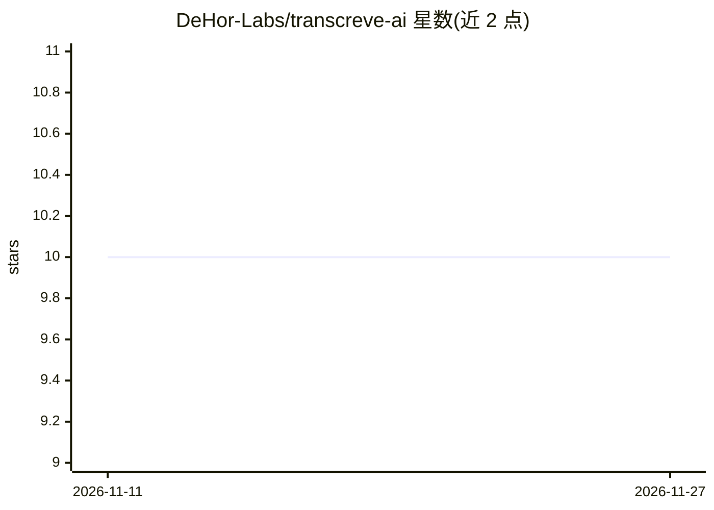

# DeHor-Labs/transcreve-ai

⭐ 10 · Python · MIT · 推送 2026-11-10 · [GitHub](https://github.com/DeHor-Labs/transcreve-ai) · 个人维护 · 中文 README

**把视频链接转为可检索多模态知识档案的 CLI 管线**

TranscreveAI 是一个视频智能 CLI 管线：通过 yt-dlp 下载视频、抽取音频、采样帧、用 tesseract 读取屏幕可见文本，并可选调用 AI 生成转录、帧视觉笔记与知识综合（摘要、章节、实体、行动项），输出含 analysis.json 与 knowledge.md 的自包含档案目录。支持 --provider 切换 openai/gemini/anthropic/local，local 模式用 faster-whisper 与 sentence-transformers 离线运行；内置 SQLite 运行历史与 SHA-256 去重、Obsidian/Notion/S3 存储后端、RAG 语义检索（index/ask）、MCP server 及面向 Codex/Claude Code 的 agent skill。本地模式无需 API key。

## 筛选速览

| 维度 | 判定 | 备注 |
|---|---|---|
| AI 角色 | `ai-native` | 本体是模型或模型工具 |
| 许可风险 | `permissive` | MIT |
| 部署形态 | `library` | 以包/库形式分发 |
| 模型依赖 | locked-api |  |
| 硬件要求 | — | 无带数字的原话,不猜 |
| 安装摩擦 | `medium` | 含编译或系统依赖之一 |
| 成熟度 | — | 结构信号不足 |

## 能力要点

- 管线覆盖下载、音频抽取、帧采样、OCR、转录到知识综合
- 支持 openai/gemini/anthropic/local 多 provider，local 模式离线且免 API key
- MCP server 暴露 analyze/agent_run/index/ask 等 10 个工具
- RAG 语义检索：分块、embedding、SQLite 余弦相似度，支持 web 界面搜索

## 适用场景

- 把教程视频转成含屏幕证据与步骤的可检索知识库
- 给本地 agent 接入视频理解能力（MCP/agent skill）
- 为创作者提取视频中的 hook、脚本变体等二创素材（--template content）
- 离线环境下转录并索引视频内容

## 场景标签

`知识库管理` `RAG` `语音识别` `多模态` · 领域:知识与检索

## 证据(README 行号)

> L25: TranscreveAI is a small but serious pipeline for video intelligence. It does not stop at speech-to-text. It downloa
> L316: TranscreveAI suporta multiplos providers de IA. Use `--provider` para escolher:
> L361: Apos analisar videos, voce pode indexar o conteudo e fazer perguntas em linguagem natural. O sistema divide cada d

## 星数曲线

2026-11-11 10 → 2026-11-27 10（+0）

---
*卡片 v1 · prompt 1.4 · 生成 2026-11-20 · 置信度 high · 依据 README sha `d4771167a345` · [字段定义](../../DATASET.md)*
