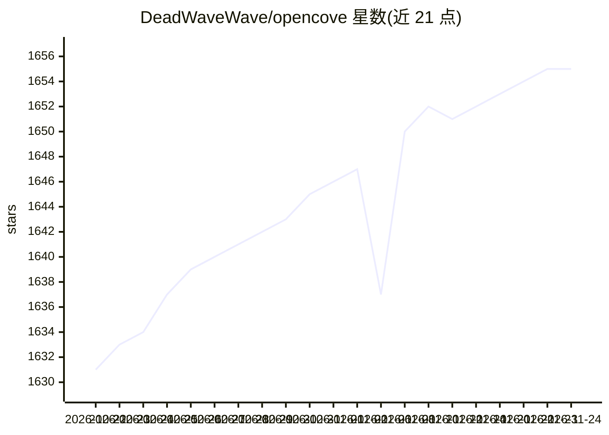

# DeadWaveWave/opencove

⭐ 1,653 · TypeScript · MIT · 推送 2026-11-21 · [GitHub](https://github.com/DeadWaveWave/opencove) · 组织维护 · 中文 README

**给 AI 编码 agent 用的无限画布工作区**

基于 Electron + React + TypeScript 的桌面应用，把 Claude Code、Codex 等 CLI agent 会话、终端、任务与笔记放在同一张无限 2D 画布上，支持并行运行多个 agent 会话、持久化布局与 agent 状态、空间快照归档、全局搜索与工作区隔离（目录/git worktree）。提供 macOS/Windows/Linux 安装包与独立 CLI/Server，可无头启动并托管 Web UI。当前处于 Alpha 阶段，官方建议早期使用者与高级用户尝试。

## 筛选速览

| 维度 | 判定 | 备注 |
|---|---|---|
| AI 角色 | `ai-ecosystem` | LLM/agent 周边工具 |
| 许可风险 | `permissive` | MIT |
| 部署形态 | `desktop` | 安装包/桌面程序 |
| 模型依赖 | — | README 未给出锁定关系 |
| 硬件要求 | — | 无带数字的原话,不猜 |
| 安装摩擦 | `low` | 无编译、无系统依赖或容器化 |
| 成熟度 | `idea` | |

## 能力要点

- 无限空间画布统一承载 agent 会话、终端、任务与笔记
- 多 agent 并行会话与重启后恢复布局、输出与状态
- 独立 CLI 支持 agent 协调（配额管理、节点读写、会话终止）
- 可无头部署 Worker 并托管局域网 Web UI

## 适用场景

- 并排运行多个 Claude Code / Codex 会话并对比输出
- 把任务计划、笔记和终端输出放在同一工作区管理
- 无头服务器上通过浏览器远程访问画布工作区

## 场景标签

`编码 Agent` `多智能体` · 领域:Agent 开发

## 证据(README 行号)

> L24: OpenCove is a **spatial development workspace** for people who work with AI coding agents every day.
> L39: - **🤖 Built for CLI agents**: Optimized for `Claude Code`, `Codex`, and similar terminal-native agent workflows.

## 星数曲线

2026-10-22 1,631 → 2026-11-24 1,655（+24）

---
*卡片 v1 · prompt 1.4 · 生成 2026-11-23 · 置信度 mid · 依据 README sha `7c09c9e62d8b` · [字段定义](../../DATASET.md)*
