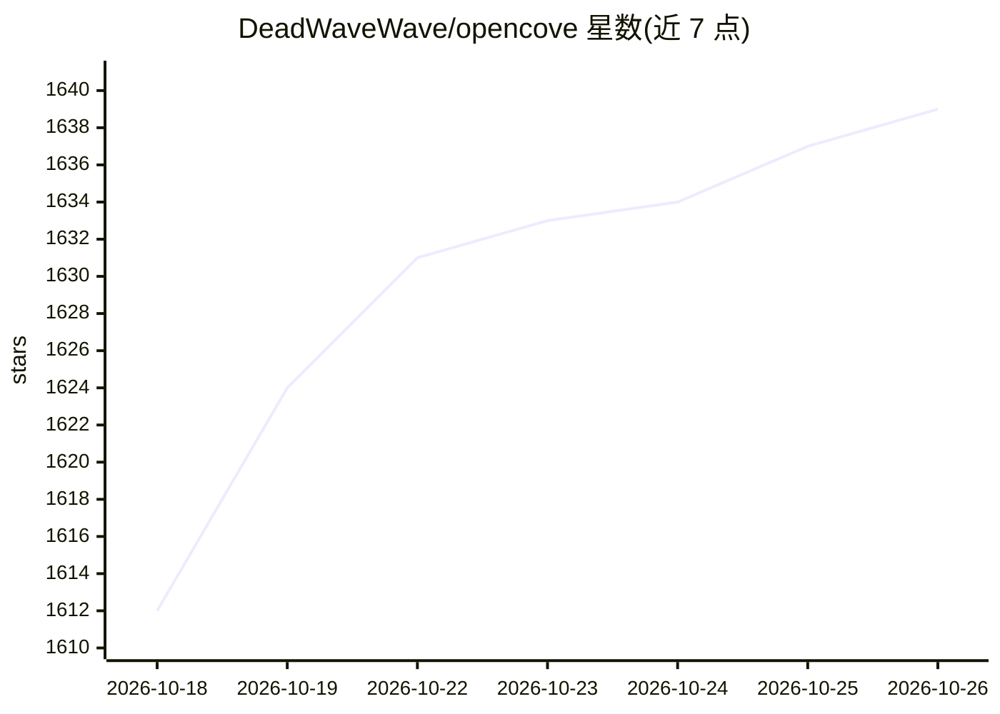

# DeadWaveWave/opencove

⭐ 1,639 · TypeScript · MIT · 推送 2026-10-17 · [GitHub](https://github.com/DeadWaveWave/opencove) · 组织维护 · 中文 README

**面向 AI 编码 agent 的无限画布式空间开发工作区（桌面应用）**

基于 Electron + React + TypeScript 的空间开发工作区：把 Claude Code、Codex 等 CLI agent 会话、终端、任务与笔记放在同一张无限 2D 画布上，支持多 agent 并行监视、工作区持久化恢复、空间快照、全局搜索与项目隔离（目录/git worktree）。提供 macOS/Windows/Linux 桌面安装包、CLI/服务器安装脚本与实验性 Worker 托管 Web UI；macOS 构建未签名需手动解除隔离，整体处于 Alpha 阶段，面向早期用户。0.4.0 起支持插件与主题独立安装。

## 筛选速览

| 维度 | 判定 | 备注 |
|---|---|---|
| AI 角色 | `ai-ecosystem` | LLM/agent 周边工具 |
| 许可风险 | `permissive` | MIT |
| 部署形态 | `desktop` | 安装包/桌面程序 |
| 模型依赖 | — | README 未给出锁定关系 |
| 硬件要求 | — | 无带数字的原话,不猜 |
| 安装摩擦 | `low` | 无编译、无系统依赖或容器化 |
| 成熟度 | `idea` | |

## 能力要点

- Claude Code / Codex 等 CLI agent 会话与终端、任务、笔记同画布并行管理
- 工作区持久化：重启后恢复视口、布局、终端输出与 agent 状态
- 空间快照（Space archives）回访历史工作区状态
- 独立安装的插件与主题体系及 Worker 托管 Web UI

## 适用场景

- 同时跑多个 Claude Code / Codex 会话并并排监控执行
- 把任务计划、笔记与终端输出收在同一个可见的工作区
- 无头服务器上托管 Web UI 从浏览器访问画布

## 场景标签

 · 领域:开发者工具/桌面工作区

## 证据(README 行号)

> L24: OpenCove is a **spatial development workspace** for people who work with AI coding agents every day.
> L39: - **🤖 Built for CLI agents**: Optimized for `Claude Code`, `Codex`, and similar terminal-native agent workflows.

## 星数曲线

2026-10-18 1,612 → 2026-10-26 1,639（+27）

---
*卡片 v1 · prompt 1.4 · 生成 2026-10-21 · 置信度 high · 依据 README sha `7d0ff57b269c` · [字段定义](../../DATASET.md)*
