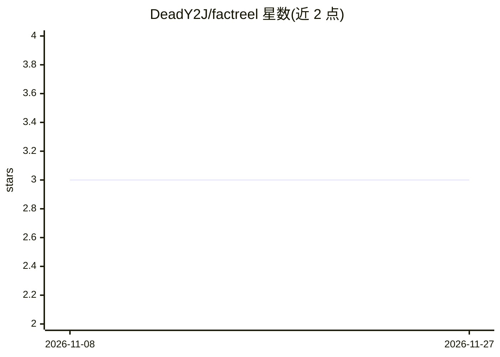

# DeadY2J/factreel

⭐ 3 · Python · MIT · 推送 2026-11-24 · [GitHub](https://github.com/DeadY2J/factreel) · [官网](https://github.com/DeadY2J/factreel#readme) · 个人维护

**从已核实事实自动生成带字幕的无脸短视频**

FactReel 是一个 Python 命令行工具，将用户提供的事实清单（可带来源）转为竖版短视频 MP4，适配 YouTube Shorts、TikTok 与 Reels。AI 仅负责把事实改写为口播脚本，脚本需通过数字白名单、重复检查、谣言标注和 temperature-0 二次事实核查等防幻觉关卡；随后串联语音合成、图像生成、逐词卡拉OK字幕与 FFmpeg 渲染。语音与图像均有多级回退链，无 API key 也可运行；可选 YouTube 自动上传并标注合成内容。

## 筛选速览

| 维度 | 判定 | 备注 |
|---|---|---|
| AI 角色 | `ai-native` | 本体是模型或模型工具 |
| 许可风险 | `permissive` | MIT |
| 部署形态 | `library` | 以包/库形式分发 |
| 模型依赖 | local-ok | 支持本地模型 |
| 硬件要求 | — | 无带数字的原话,不猜 |
| 安装摩擦 | `medium` | 含编译或系统依赖之一 |
| 成熟度 | — | 结构信号不足 |

## 能力要点

- 防幻觉脚本关卡：数字白名单、重复检查、RUMOR 标注、二次核查与仅事实回退
- 语音回退链：Edge 神经语音→ElevenLabs→Cloudflare Aura→系统离线语音
- 图像回退链：FLUX 云服务→本地生成器→历史图像→离线程序化背景
- 支持任意 OpenAI 兼容 LLM，付费服务均可选且有预算上限

## 适用场景

- 无人值守每日定时发布事实类短视频
- 英西双语账号批量制作带逐词字幕的 Shorts
- 免费方案（零 API key）先出预览再加 key 解锁 AI 功能

## 场景标签

`图像生成` `语音合成` `视频生成` `AI 写作` · 领域:内容生成

## 证据(README 行号)

> L3: **Fact-checked faceless short videos, on autopilot.**
> L39: - 🛡️ **Anti-hallucination script writer**: number whitelist, repetition check, rumour labelling, a
> L50: - 🔌 **Any OpenAI-compatible LLM**: NVIDIA NIM, Google Gemini (free tier), OpenRouter, Groq, OpenAI, Ollama, LM Stud

## 星数曲线

2026-11-08 3 → 2026-11-27 3（+0）

---
*卡片 v1 · prompt 1.4 · 生成 2026-11-22 · 置信度 high · 依据 README sha `92fac36dda08` · [字段定义](../../DATASET.md)*
