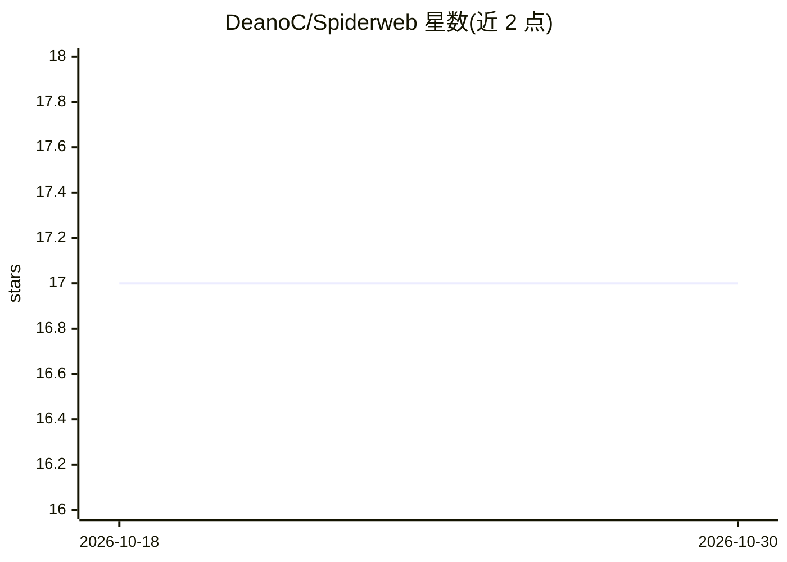

# DeanoC/Spiderweb

⭐ 17 · Zig · MIT · 推送 2026-04-03 · [GitHub](https://github.com/DeanoC/Spiderweb) · [官网](https://mind-swarm.ai) · 个人维护

**AI agent 的分布式工作区主机与 RPC 文件系统**

用 Zig 编写的 workspace 主机与分布式 RPC 文件系统，为外部 AI agent 进程提供挂载的工作区命名空间（/.spiderweb 下的 control/catalog/venoms 三个根）、节点管理与控制面；agent 本体运行在 Spiderweb 之外，通过挂载的文件系统契约操作，外部 worker 自行管理模型配置与凭证。提供 spiderweb-fs-mount 独立挂载客户端，支持 Linux/Windows/macOS，macOS 优先原生 FSKit 后端、macFUSE 为回退。构建需 Zig 编译，Linux/macOS 运行主机。

## 筛选速览

| 维度 | 判定 | 备注 |
|---|---|---|
| AI 角色 | `ai-ecosystem` | LLM/agent 周边工具 |
| 许可风险 | `permissive` | MIT |
| 部署形态 | `desktop` | 安装包/桌面程序 |
| 模型依赖 | — | README 未给出锁定关系 |
| 硬件要求 | — | 无带数字的原话,不猜 |
| 安装摩擦 | `low` | 无编译、无系统依赖或容器化 |
| 成熟度 | `idea` | |

## 能力要点

- 三个规范根（control/catalog/venoms）的挂载工作区契约
- spiderweb-fs-mount 独立客户端支持 Linux/Windows/macOS
- macOS 原生 FSKit 后端，macFUSE 作为回退路径
- 内置 terminal/git/search_code 公共能力与节点伴生进程管理

## 适用场景

- 让多个 agent 通过文件系统接口跨机器协作
- 为 agent 提供统一的挂载命名空间替代定制 API
- 在不承载主机的机器上通过独立客户端挂载工作区

## 场景标签

 · 领域:AI agent 基础设施/分布式系统

## 证据(README 行号)

> L7: Spiderweb is a **workspace host + distributed RPC filesystem** for AI agents. It provides the mounted workspace, nod
> L18: In short: **Spiderweb hosts the namespace; external runtimes operate through it**.
> L118: - Spider Monkey is the first external worker for this model, but the intent is broader: any agent that can work ag

## 星数曲线

2026-10-18 17 → 2026-10-30 17（+0）

---
*卡片 v1 · prompt 1.4 · 生成 2026-10-30 · 置信度 high · 依据 README sha `5d672c442149` · [字段定义](../../DATASET.md)*
