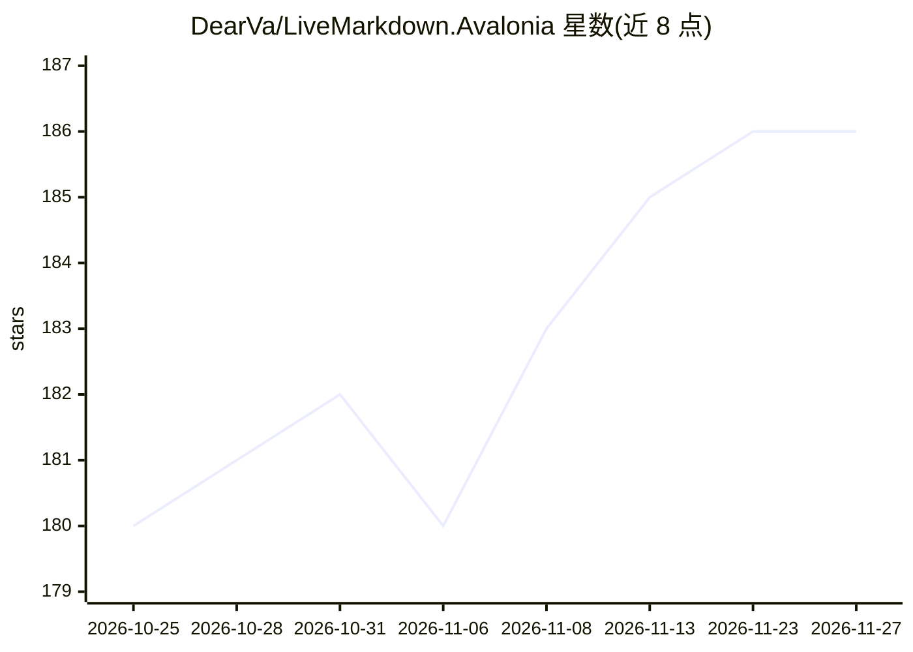

# DearVa/LiveMarkdown.Avalonia

⭐ 186 · C# · Apache-2.0 · 推送 2026-11-26 · [GitHub](https://github.com/DearVa/LiveMarkdown.Avalonia) · 个人维护 · 中文 README

**给 Avalonia 应用提供 Markdown 实时流式渲染的 UI 组件库**

面向 Avalonia 桌面应用的 Markdown 渲染库，以 NuGet 包分发，核心是可嵌入 XAML 的 MarkdownRenderer 控件与 ObservableStringBuilder 流式构建 API——内容变更触发增量更新可视树而非整篇重渲染，并提供流式文本渐入动画选项。支持表格、代码高亮（TextMateSharp）、可选中文本、搜索高亮、异步图片加载与缓存；LaTeX、SVG、Mermaid 图表通过可选子包启用。定位场景是显示大模型流式输出的应用界面，安装需 .NET 8/10/11 与 Avalonia 12。

## 筛选速览

| 维度 | 判定 | 备注 |
|---|---|---|
| AI 角色 | `ai-ecosystem` | LLM/agent 周边工具 |
| 许可风险 | `permissive` | Apache-2.0 |
| 部署形态 | `None` |  |
| 模型依赖 | — | README 未给出锁定关系 |
| 硬件要求 | — | 无带数字的原话,不猜 |
| 安装摩擦 | `medium` | 含编译或系统依赖之一 |
| 成熟度 | — | 结构信号不足 |

## 能力要点

- 基于 Markdig 的增量式实时渲染，针对流式输出场景设计
- LaTeX（RaTeX）、SVG、Mermaid 图表渲染以可选 NuGet 子包提供
- 支持 TextMateSharp 代码高亮、跨元素文本选择与搜索高亮
- 图片异步加载，带内存/文件缓存及 HTTP 新鲜度头校验

## 适用场景

- 开发 AI 聊天客户端时渲染大模型流式返回的 Markdown 回复
- 桌面应用内实时展示动态更新的 Markdown 文档
- 在 Avalonia 应用中渲染含数学公式与 Mermaid 图的内容

## 场景标签

`聊天机器人` · 领域:对话与助手

## 证据(README 行号)

> L5: **High performance, real-time Markdown renderer for AI/LLM**
> L18: `LiveMarkdown.Avalonia` is a High-performance Markdown viewer for Avalonia applications.
> L20: updating, **especially when streaming large model outputs**.

## 星数曲线

2026-10-25 180 → 2026-11-27 186（+6）

---
*卡片 v1 · prompt 1.4 · 生成 2026-11-27 · 置信度 high · 依据 README sha `0616aa815146` · [字段定义](../../DATASET.md)*
