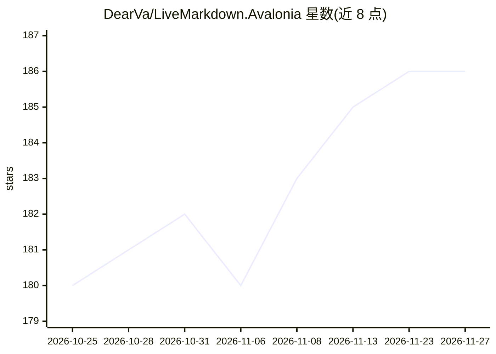

# DearVa/LiveMarkdown.Avalonia

⭐ 186 · C# · Apache-2.0 · 推送 2026-11-26 · [GitHub](https://github.com/DearVa/LiveMarkdown.Avalonia) · 个人维护 · 中文 README

**Avalonia 应用的 Markdown 实时渲染控件：流式呈现 LLM 输出**

面向 Avalonia 桌面/跨平台应用的 Markdown 渲染库，通过 ObservableStringBuilder 事件驱动增量更新可视树，实现内容流式到达时的实时重渲染，README 明确指出适用于流式呈现大模型输出的场景。基于 Markdig 解析渲染，提供 TextMateSharp 代码高亮、RaTeX 数学公式、Mermaider 图表（流程图/时序图/类图等 13 种）、异步图片加载与内存/文件缓存、可扩展渲染管线与节点注册。通过 NuGet 分发，支持 .NET 8/10/11 与 Avalonia 12。

## 筛选速览

| 维度 | 判定 | 备注 |
|---|---|---|
| AI 角色 | `ai-ecosystem` | LLM/agent 周边工具 |
| 许可风险 | `permissive` | Apache-2.0 |
| 部署形态 | `None` |  |
| 模型依赖 | — | README 未给出锁定关系 |
| 硬件要求 | — | 无带数字的原话,不猜 |
| 安装摩擦 | `medium` | 含编译或系统依赖之一 |
| 成熟度 | — | 结构信号不足 |

## 能力要点

- 基于事件驱动的增量更新，适配流式 Markdown 内容
- LaTeX（RaTeX）与 13 种 Mermaid 图表的原生渲染，通过可选包启用
- 图片异步加载与内存/文件两级缓存，支持 HTTP 新鲜度头
- 可扩展 Markdown 管线：自定义节点注册与节点生命周期钩子

## 适用场景

- 为聊天式应用流式渲染大模型返回的 Markdown
- 在 Avalonia 应用中展示含公式与图表的技术文档
- 需要文本可选、可搜索高亮的 Markdown 阅读界面

## 场景标签

 · 领域:开发工具/UI 组件

## 证据(README 行号)

> L18: `LiveMarkdown.Avalonia` is a High-performance Markdown viewer for Avalonia applications.
> L20: updating, **especially when streaming large model outputs**.
> L122: `MarkdownBuilder` is the primary API for live output. Its change events let the renderer update the visual tree

## 星数曲线

2026-10-25 180 → 2026-11-27 186（+6）

---
*卡片 v1 · prompt 1.4 · 生成 2026-11-26 · 置信度 high · 依据 README sha `7842c3e9ecc7` · [字段定义](../../DATASET.md)*
