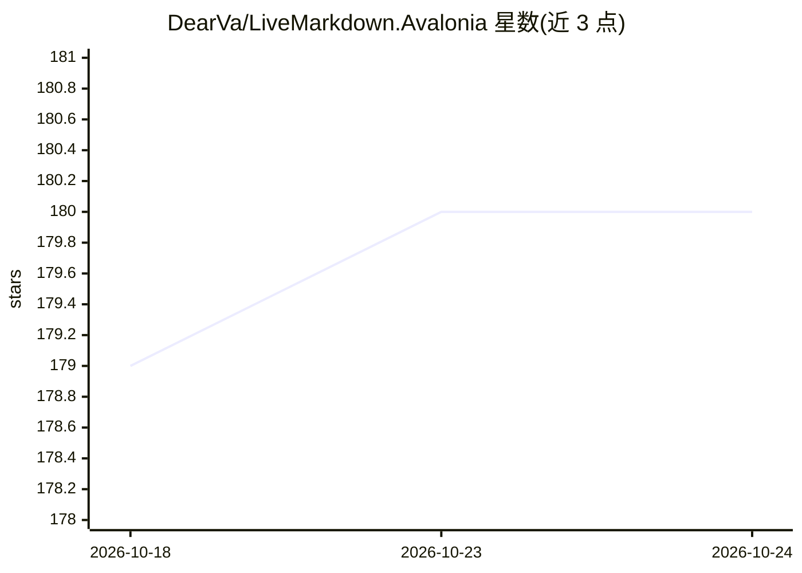

# DearVa/LiveMarkdown.Avalonia

⭐ 180 · C# · Apache-2.0 · 推送 2026-10-22 · [GitHub](https://github.com/DearVa/LiveMarkdown.Avalonia) · 个人维护 · 中文 README

**面向 Avalonia 应用的实时 Markdown 渲染控件，适配 LLM 流式输出**

基于 Markdig 的高性能 Markdown 渲染库，供 Avalonia（.NET 8/10）应用程序嵌入使用。核心机制是通过 MarkdownBuilder 的变更事件增量更新可视树，实现内容追加时的实时重渲染，README 明确说明当前仅支持 Append 和 Clear 操作，足以覆盖大模型流式输出场景。功能包括表格、代码高亮（TextMateSharp）、跨元素文本选择、文本搜索与高亮、图片异步加载，LaTeX/SVG/Mermaid 以可选 NuGet 扩展包形式提供。开发者以 XAML 控件 + C# API 方式集成。

## 筛选速览

| 维度 | 判定 | 备注 |
|---|---|---|
| AI 角色 | `ai-ecosystem` | LLM/agent 周边工具 |
| 许可风险 | `permissive` | Apache-2.0 |
| 部署形态 | `None` |  |
| 模型依赖 | — | README 未给出锁定关系 |
| 硬件要求 | — | 无带数字的原话,不猜 |
| 安装摩擦 | `medium` | 含编译或系统依赖之一 |
| 成熟度 | — | 结构信号不足 |

## 能力要点

- 通过 MarkdownBuilder 变更事件实现增量实时重渲染（支持 Append/Clear）
- 跨元素可选中文本与文本搜索/自定义高亮（UTF-16 坐标）
- LaTeX（RaTeX）、Mermaid 图表（多种图类型与 Pan&Zoom）、SVG 以可选扩展包启用
- 可注册自定义 Markdown 节点扩展渲染管线

## 适用场景

- 在桌面 AI 应用中流式展示大模型的 Markdown 输出
- 为聊天客户端渲染含代码块、表格、公式与 Mermaid 图的回答
- 在已渲染或离屏 Markdown 中实现搜索与高亮定位

## 场景标签

 · 领域:桌面 UI 组件/LLM 应用界面

## 证据(README 行号)

> L18: `LiveMarkdown.Avalonia` is a High-performance Markdown viewer for Avalonia applications.
> L20: updating, **especially when streaming large model outputs**.
> L38: > This library currently only supports `Append` and `Clear` operations on the Markdown content, which is enough for

## 星数曲线

2026-10-18 179 → 2026-10-24 180（+1）

---
*卡片 v1 · prompt 1.4 · 生成 2026-10-22 · 置信度 high · 依据 README sha `dd059b095bbb` · [字段定义](../../DATASET.md)*
