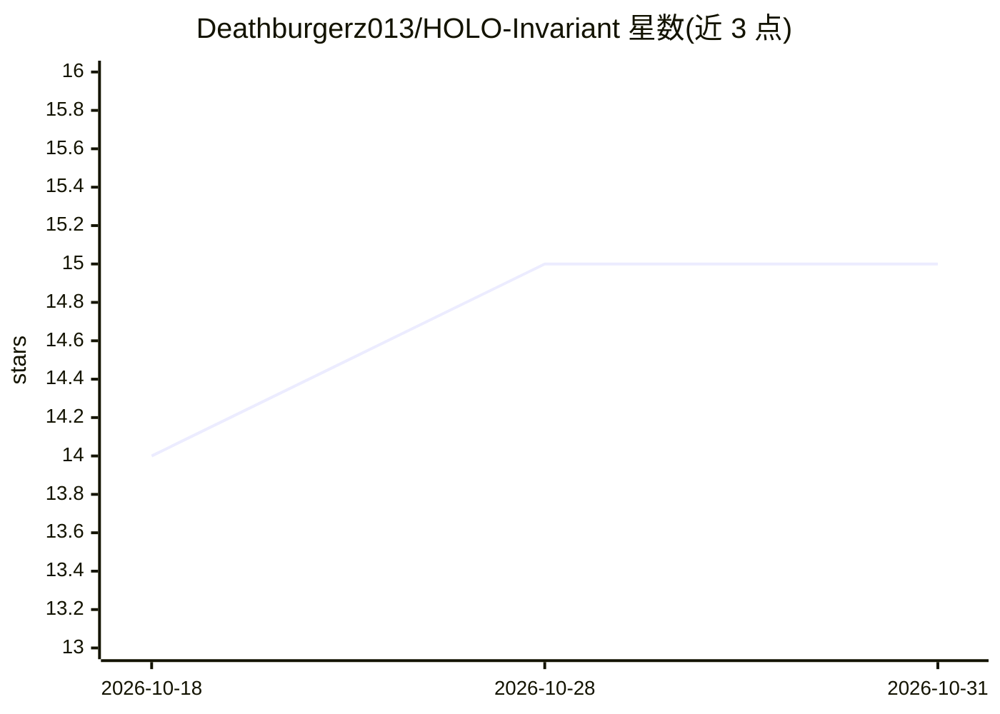

# Deathburgerz013/HOLO-Invariant

⭐ 15 · Python · MIT · 推送 2026-10-30 · [GitHub](https://github.com/Deathburgerz013/HOLO-Invariant) · 个人维护

**AI 会话/交接场景下的状态连续性验证框架**

Python 框架，面向需要在会话、模型、工具与执行环境之间保持可验证状态的开发者。它将连续性外化为可检查的工件：追加式 SHA-256 链接历史、修正谱系保留原始记录、确定性规范 JSON 身份、精确 schema 校验、执行许可与授权分离。提供 18 个 CLI 命令、3 个公共 schema 与 MCP 工具，附 EnvPath 本地界面（搜索与草稿导出无需模型，聊天需已安装的 Ollama 模型）。明确声明不建立真相、权限或通用智能，跨模型连续性仍为实证目标。

## 筛选速览

| 维度 | 判定 | 备注 |
|---|---|---|
| AI 角色 | `ai-ecosystem` | LLM/agent 周边工具 |
| 许可风险 | `permissive` | MIT |
| 部署形态 | `library` | 以包/库形式分发 |
| 模型依赖 | local-ok | 支持本地模型 |
| 硬件要求 | — | 无带数字的原话,不猜 |
| 安装摩擦 | `low` | 无编译、无系统依赖或容器化 |
| 成熟度 | — | 结构信号不足 |

## 能力要点

- 追加式 SHA-256 链接历史与修正谱系保留原始记录
- 验证与授权分离：观测回执不授予写/执行权限
- 面向 LangGraph/Temporal/Letta/in-toto 的无依赖协议适配器
- 18 个 CLI 命令、公开基准 fixture 与 CI 可复现评测

## 适用场景

- 跨会话/跨模型交接时保留并核验修正与证据
- 对任意连续性系统按公开 fixture 打分评测
- 为 agent 记忆编辑提供提案边界而非直接写入

## 场景标签

`Agent 记忆` `模型评测` · 领域:Agent 开发

## 证据(README 行号)

> L54: HOLO-Invariant is a Python framework for preserving, reconstructing, and
> L55: checking state across sessions, models, tools, and execution environments.
> L62: HOLO is not a model, agent, vector database, or autonomous authority. It is a

## 星数曲线

2026-10-18 14 → 2026-10-31 15（+1）

---
*卡片 v1 · prompt 1.4 · 生成 2026-10-30 · 置信度 mid · 依据 README sha `58c8797e39e2` · [字段定义](../../DATASET.md)*
