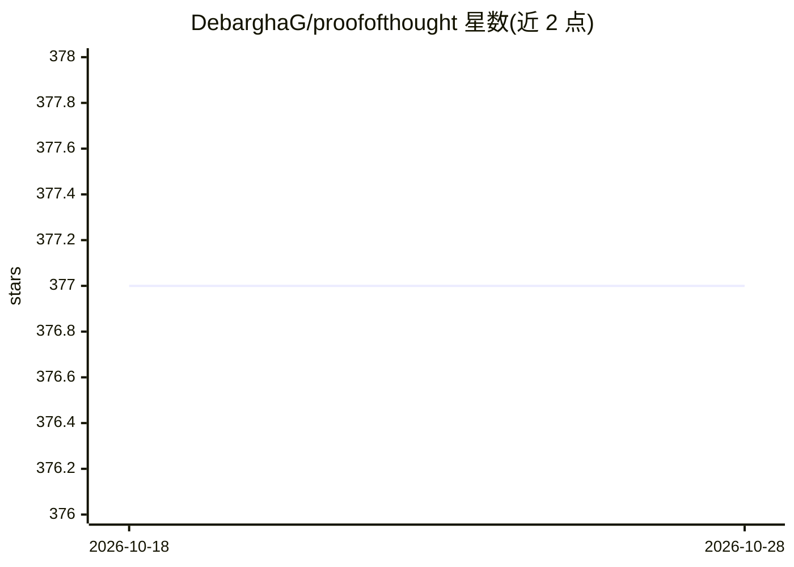

# DebarghaG/proofofthought

⭐ 377 · Python · MIT · 推送 2026-07-07 · [GitHub](https://github.com/DebarghaG/proofofthought) · [官网](https://debarghag.github.io/proofofthought/) · 个人维护

**结合 LLM 与 Z3 定理证明器的神经符号推理 Python 库**

ProofOfThought 是一个 Python 3.12 库（PyPI 包名 proofofthought，导入名 z3adapter），将 LLM 生成的推理转译为 Z3 定理证明器执行，支持 SMT2（默认）与自定义 JSON DSL 两种执行后端，原生集成 OpenAI 与 Azure OpenAI（GPT-4o/GPT-5）。提供高层 API、批量评测管线，以及 Self-Refine、Self-Consistency、Decomposed/Least-to-Most Prompting 等后处理技术。在 ProntoQA、FOLIO、ProofWriter、ConditionalQA、StrategyQA 五个数据集上给出基准结果；可作为 LLM+Solver 方法的基线使用。

## 筛选速览

| 维度 | 判定 | 备注 |
|---|---|---|
| AI 角色 | `ai-ecosystem` | LLM/agent 周边工具 |
| 许可风险 | `permissive` | MIT |
| 部署形态 | `library` | 以包/库形式分发 |
| 模型依赖 | locked-api |  |
| 硬件要求 | — | 无带数字的原话,不猜 |
| 安装摩擦 | `low` | 无编译、无系统依赖或容器化 |
| 成熟度 | — | 结构信号不足 |

## 能力要点

- LLM+Z3 定理证明的神经符号推理，SMT2 与 JSON DSL 双后端
- 原生 Azure OpenAI 集成（GPT-4o/GPT-5）与 OpenAI 支持
- Self-Refine、Self-Consistency 等四种后处理技术
- 内置 5 个推理数据集的批量评测管线与基准结果

## 适用场景

- 在 LLM 推理任务中引入形式化求解器以保证推理正确性
- 在 FOLIO、ProofWriter 等逻辑推理数据集上做批量评测
- 作为 LLM+Solver 方法的实验基线复现与改进

## 场景标签

`模型评测` · 领域:评测与运维

## 证据(README 行号)

> L10: LLM-based reasoning using Z3 theorem proving with multiple backend support (SMT2 and JSON).
> L17: - **High-level API**: Simple Python interface for reasoning tasks
> L139: 1. **High-level API** (`z3adapter.reasoning`) - Simple Python interface for reasoning tasks

## 星数曲线

2026-10-18 377 → 2026-10-28 377（+0）

---
*卡片 v1 · prompt 1.4 · 生成 2026-10-22 · 置信度 high · 依据 README sha `9a4d178085d1` · [字段定义](../../DATASET.md)*
