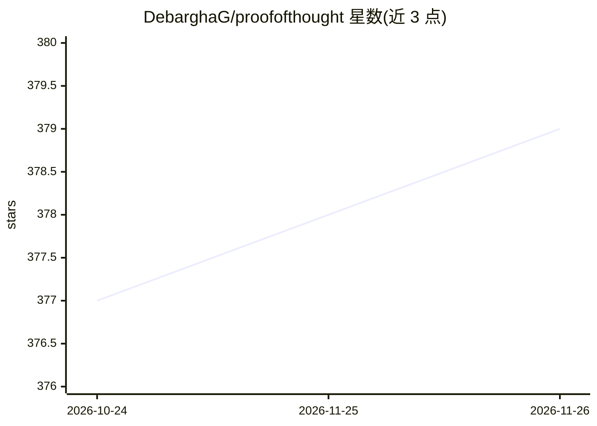

# DebarghaG/proofofthought

⭐ 379 · Python · MIT · 推送 2026-10-31 · [GitHub](https://github.com/DebarghaG/proofofthought) · [官网](https://debarghag.github.io/proofofthought/) · 组织维护

**用 Z3 定理证明为 LLM 推理提供可验证输出的 Python 库**

Python 库，将 LLM 推理任务编码为 SMT 程序并交由 Z3 求解，输出带有 proof_status 与可机检轨迹的答案。v2.0 起默认为 agentic SMT-LIB scratchpad 后端：模型迭代调用 z3_solve 工具、读取 sat/unsat 判定、修复编码后以 finish 结束，典型路径为反证法；保留 smt2 与 json 两种单次生成后端。附批量评测流水线（ProntoQA 等 5 个数据集）与 Self-Refine、Self-Consistency 等后处理技术（仅限单次后端）。需要 Python 3.12 及 OpenAI 或 Azure OpenAI 凭据。

## 筛选速览

| 维度 | 判定 | 备注 |
|---|---|---|
| AI 角色 | `ai-ecosystem` | LLM/agent 周边工具 |
| 许可风险 | `permissive` | MIT |
| 部署形态 | `library` | 以包/库形式分发 |
| 模型依赖 | local-ok | 支持本地模型 |
| 硬件要求 | — | 无带数字的原话,不猜 |
| 安装摩擦 | `low` | 无编译、无系统依赖或容器化 |
| 成熟度 | — | 结构信号不足 |

## 能力要点

- agentic 循环：z3_solve ⇄ finish 工具调用，答案附带可复检的 SMT 程序轨迹（AgenticBackend.reverify）
- 三种执行后端：agentic（默认）、smt2、json
- 支持 Azure OpenAI 与本地 OpenAI 兼容端点（vLLM/sglang）
- 内置 5 个数据集的批量评测流水线与 4 种后处理技术

## 适用场景

- 为 LLM 逻辑推理结果附加形式化证明轨迹
- 在 FOLIO、ProofWriter 等推理数据集上批量评测 LLM+Solver 方法
- 通过本地 vLLM/sglang 端点运行可验证推理流程

## 场景标签

`模型评测` · 领域:评测与运维

## 证据(README 行号)

> L10: LLM-based reasoning using Z3 theorem proving — now built around an **agentic SMT-LIB scratchpad** (with the classic
> L20: - **Agentic SMT-LIB Scratchpad (new default)**: Iterative `z3_solve` ⇄ `finish` tool loop with verdict-aware nudges
> L24: - **High-level API**: Simple Python interface for reasoning tasks

## 星数曲线

2026-10-24 377 → 2026-11-26 379（+2）

---
*卡片 v1 · prompt 1.4 · 生成 2026-11-25 · 置信度 high · 依据 README sha `6bada1896cd5` · [字段定义](../../DATASET.md)*
