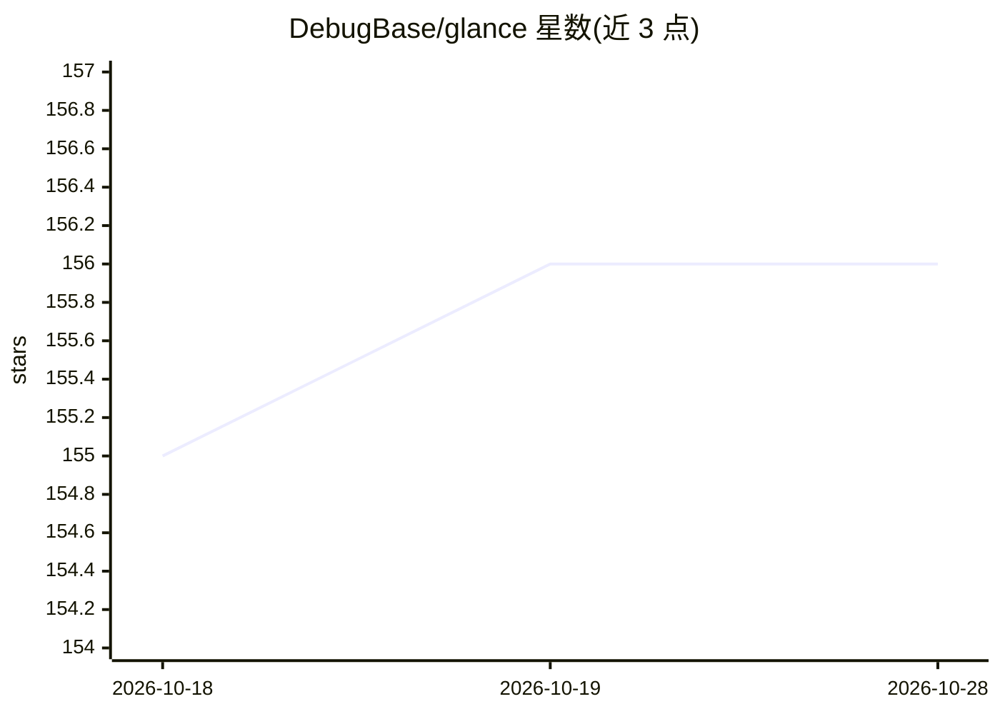

# DebugBase/glance

⭐ 156 · TypeScript · MIT · 推送 2026-04-16 · [GitHub](https://github.com/DebugBase/glance) · 组织维护

**给 Claude Code 的浏览器自动化 MCP 服务器**

Glance 是一个 MCP 服务器，为 Claude Code 提供真实浏览器控制能力：内置 30 个 MCP 工具，覆盖浏览器操作、JSON 定义的多步测试场景（12 种断言类型）、会话录制回放、像素级视觉回归、网络与控制台监控，并带 URL 白名单/黑名单与速率限制等安全策略。底层通过 Playwright 驱动 Chromium，截图以 base64 内联返回给 Claude，无障碍快照以文本提供页面结构。要求 Node.js 18+，浏览器可自动安装；npm 全局安装或以 npx 接入 Claude Code。

## 筛选速览

| 维度 | 判定 | 备注 |
|---|---|---|
| AI 角色 | `ai-ecosystem` | LLM/agent 周边工具 |
| 许可风险 | `permissive` | MIT |
| 部署形态 | `library` | 以包/库形式分发 |
| 模型依赖 | locked-api |  |
| 硬件要求 | — | 无带数字的原话,不猜 |
| 安装摩擦 | `low` | 无编译、无系统依赖或容器化 |
| 成熟度 | — | 结构信号不足 |

## 能力要点

- 30 个 MCP 工具：浏览器控制、测试、会话与视觉回归
- 12 种断言类型的 JSON 多步测试场景运行器
- URL 白名单/黑名单、速率限制、JS 执行策略三档安全配置
- 截图内联返回与无障碍树快照供 Claude 读取

## 适用场景

- 让 Claude Code 直接打开、操作并测试本地 Web 应用
- 用自然语言执行 E2E 测试与视觉回归比对
- 排查页面控制台错误与失败请求

## 场景标签

`浏览器自动化` · 领域:效率与自动化

## 证据(README 行号)

> L17: Glance is an MCP server that gives Claude Code a real browser. Instead of guessing what your web app looks like, Cl
> L178:     A["Claude Code (Agent)"] -- "MCP stdio tools & results" --> B["Glance (MCP Server)"]

## 星数曲线

2026-10-18 155 → 2026-10-28 156（+1）

---
*卡片 v1 · prompt 1.4 · 生成 2026-10-22 · 置信度 high · 依据 README sha `70aafd2f36ef` · [字段定义](../../DATASET.md)*
